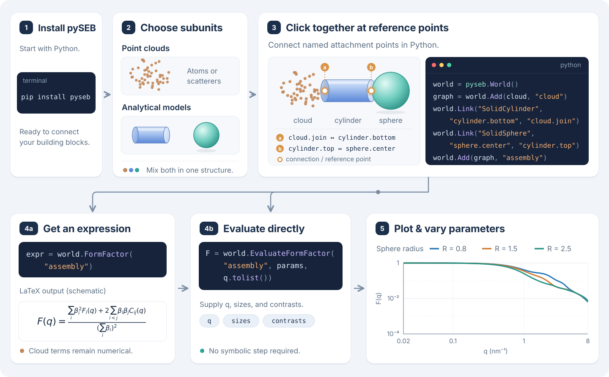
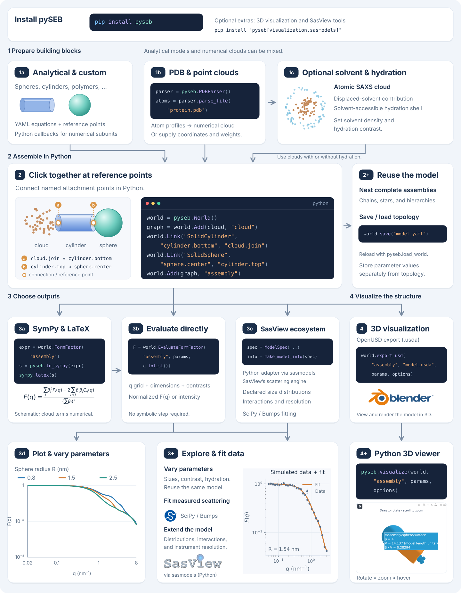

pySEB is the Python interface to the Scattering Equation Builder. It constructs
small-angle-scattering expressions for composite structures assembled by
connecting reusable subunits at named or distributed reference points.

## Connect subunits, calculate, and explore

{#fig-about-workflow fig-alt="Install pySEB with pip install pyseb. Choose point clouds and analytical shapes, then connect named reference points using Python World.Add and World.Link calls. The assembly branches to an expression with a schematic LaTeX equation or direct numerical evaluation. A plot shows three sphere-radius choices." width="100%"}

Think of subunits as building blocks that “click” together at reference points.
Each block can be an analytical model or a point cloud; both can coexist in
one assembly. In Python, `Add` introduces a block and `Link` connects named
reference points.

From the same structure graph, request a scattering expression with
`FormFactor`, or supply parameters and a q grid to `EvaluateFormFactor`
for direct numerical results. Expressions involving clouds retain numerical
cloud terms. Plot the results, change dimensions or contrasts, and evaluate
again without rebuilding the topology.

Follow [the mixed cloud and analytical model example](tutorials/mixed-model-evaluation.qmd)
to run the assembly shown here, or explore
[symbolic expressions](tutorials/symbolic-expressions.qmd) and
[parameter sweeps](tutorials/first-model.qmd#9-reuse-the-graph-with-other-radii).

## Explore the full workflow

Follow the branches from analytical models and PDB-derived clouds through
assembly, symbolic output, fitting, and 3D visualization.

{#fig-about-workflow-full fig-alt="Analytical and custom subunits, PDB files, and optionally hydrated numerical clouds feed a connected Python assembly. The model can be nested or saved, converted to SymPy and LaTeX, evaluated directly, or used with the SasView model engine through sasmodels. Outputs include parameter sweeps, a simulated-data fit, OpenUSD export for Blender, and a screenshot of the Python Plotly viewer with an active hover label." width="100%"}

[View full size](figures/about-workflow-full.svg){target="_blank" rel="noopener"}

## What pySEB provides

- Analytic YAML subunits, callback-defined numerical subunits, Debye sphere
  clouds, PDB-derived atom clouds, and atomic SAXS clouds with Fraser/Pontius
  displaced volumes and bundled FreeSASA solvent accessibility.
- Reusable nested structures for chains, stars, micelles, dendrimers, and other
  connected models.
- Normalized and unnormalized form factors, amplitudes, phase factors, and size
  measures.
- Direct scalar and vector evaluation, symbolic inspection, parameter sweeps,
  and contrast variation.
- Versioned YAML world import and export for portable structure topology.
- Deterministic OpenUSD visualization with random or readability-optimized
  representative layouts.
- Linux, macOS, and Windows wheels plus a public C++ API.

## Architecture

| Layer | Responsibility |
| --- | --- |
| Native C++ core | Structure graphs, scattering traversal, numerical evaluation, model and world I/O, and OpenUSD export |
| Portable symbolic backend | Dependency-light symbolic expressions used by the standard Python package and portable C++ builds |
| Optional GiNaC backend | Native C++ symbolic algebra for builds that explicitly enable GiNaC |
| Python package | Python bindings, NumPy-oriented evaluation workflows, SymPy conversion, command-line tools, and examples |
| YAML model catalogue | Validated analytic subunit equations, references, validation cases, and representative visual geometry |

The same public structure concepts—`World`, `Add`, `Link`, names, tags, and
reference points—are available from Python and C++. Visualization remains
separate from the orientationally averaged scattering calculation: it provides
one deterministic representative realization of the model topology.

## Documentation

- [Tutorials](tutorials/index.qmd) provide task-oriented, tested examples.
- [Using pySEB](using-pyseb.qmd) links to installation, visualization, model
  files, and troubleshooting.
- [Theory](theory.qmd) introduces model assumptions and intensity conventions.
- [Explore building blocks](tutorials/custom-yaml-workflow.qmd) introduces the model
  catalogue and leads to custom definitions, validation, and portable models.
- The [Reference Wiki](https://github.com/Tobionecenobi/pySEB/wiki) contains
  build guides, theory, API summaries, model references, validation details,
  and troubleshooting.

## Project information

- [Publications and citation](https://github.com/Tobionecenobi/pySEB/wiki/Publications-and-Citation)
- [Project status and roadmap](https://github.com/Tobionecenobi/pySEB/wiki/Project-Status-and-Roadmap)
- [Contributing](https://github.com/Tobionecenobi/pySEB/wiki/Contributing)
