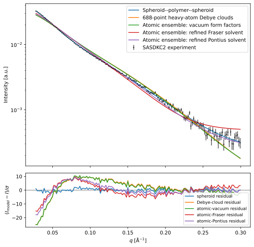
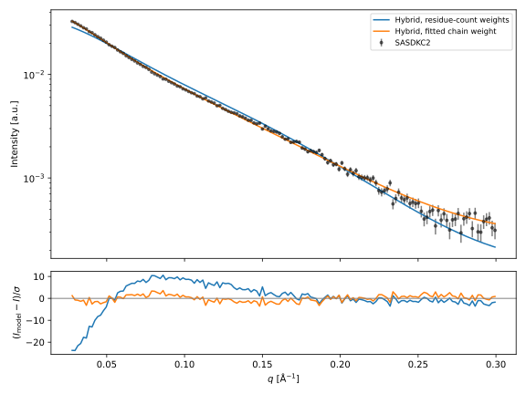

# Linked-titin fit with spatial hydration

Rerun on 2026-10-15 using atomic implementation commit `bc2f852c` and
`docs/tutorials/fit-linked-titin.qmd`. The domain clouds now select
`SpatialShell`, `Pepsi3`, and `BondedWater` explicitly, including the
visualization clouds. Four fixed 1TIU conformations are averaged.

The hydration correction improves agreement with experimental SASDKC2 data,
but the current construct model still fits poorly.

| Model | Training reduced χ² | Held-point mean squared standardized residual |
| --- | ---: | ---: |
| Fraser, excluded solvent | 55.213 | 50.761 |
| Fraser, fixed hydration | 43.953 | 40.339 |
| Fraser, refined solvent | 23.711 | 21.658 |
| Pontius, excluded solvent | 91.765 | 84.587 |
| Pontius, fixed hydration | 68.271 | 62.887 |
| Pontius, refined solvent | 25.636 | 22.992 |

Fixed hydration contrast is +0.0135 e/ų and the volume multiplier is 1.
The refined Fraser multiplier is 1.141298 and contrast is +0.053991 e/ų.
Pontius reaches 1.157625 and +0.054000 e/ų. Both hydration contrasts are
within the tutorial's 0.0001 bound tolerance; Pontius also reaches the volume
upper bound. Both optimizers stop at 30 function evaluations. These are
evaluation-limited results, not converged optima. Neither passes the tutorial's
acceptance rule. Increasing the evaluation limit alone would not resolve
the pressure against the physical bounds.

The previous saved render reported refined training χ² of 49.072 (Fraser)
and 61.715 (Pontius), also without convergence. That render predates the
current atomic implementation, so it is historical context rather than a
controlled hydration-only comparison. The dry/fixed-hydration comparisons
above use the same current implementation and conformations.



There are 75 training and 75 alternating held points. Nearby q points may
be correlated; the held-point score is not an independent validation dataset.
The linker and tails remain Gaussian polymers with residue-count scattering
weights. Domain orientation correlations, complete construct coordinates,
and excluded volume between subunits remain missing. The solvent bound hits
and large residuals do not support interpreting this as a reliable structural
fit. Matching Pepsi's hydration component does not validate these construct
assumptions.

The deposited-fit χ² of 1.068 remains far below these results. The next
structural comparison should use complete-construct conformations, including
linker and tails, with consistent atomic scattering weights.

Reproduce from the repository root:

```bash
HOME=/tmp QUARTO_PYTHON="$PWD/.venv-sympy/bin/python" \
  .tools/quarto-1.9.38/bin/quarto render \
  docs/tutorials/fit-linked-titin.qmd --to html
```

The full render completed successfully. The two hydration-reference tests
also passed. Rounded results and input hashes are saved in
[summary.json](data/titin-spatial-hydration/summary.json).

## Follow-up: retain the hybrid and test relative chain weights

The tutorial's new fourth step keeps the Fraser atomic domains, spatial
hydration, and analytical Gaussian linker and tails. It fixes the solvent
settings at volume multiplier 1 and contrast +0.0135 e/ų, and fits one
common multiplier on the three chain amplitude weights. A multiplier of 1
reproduces the previous curve, checked numerically at all stored q values.

Executing this section and its prerequisite atomic cells gives:

| Quantity | Fitted value |
| --- | ---: |
| Chain amplitude multiplier | 2.751742 |
| Linker Rg | 9.000 Å (upper bound) |
| Terminal-chain Rg8 | 18.292044 Å |
| Scale | 0.04442434 |
| Background | 0.00009145745 |
| Training reduced χ² (five parameters) | 2.465641 |
| Held-point score | 2.394246 |

The optimizer converges by `ftol` in 11 function evaluations. The multiplier
is inside the exploratory [0.25, 4] interval. Relative weighting is therefore
a substantial sensitivity in this hybrid. The multiplier remains empirical,
and the linker bound and large terminal-chain size still indicate
compensation. This is a useful next diagnostic, rather than a completed
physical contrast calculation or a unique structural determination.



Full-precision parameters are in
[relative-chain-weight.json](data/titin-spatial-hydration/relative-chain-weight.json).
All stages have now been regenerated using `Examples/generate_linked_titin.py`.
The tutorial loads numerical results and six OpenUSD scenes from
`docs/tutorials/data/titin-results/`, retaining the generating code in visible
cells. The full saved-data render completed in 14.8 seconds; regeneration took
about 13 minutes. Rendering-cell checks confirmed that pySEB and SciPy are not
imported, while saved curves, fit statistics, scene contents, and provenance
checks agree. Quarto copies the numerical assets and downloadable scenes into
the website output.
