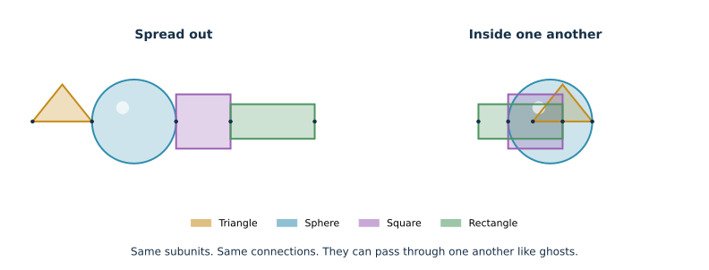
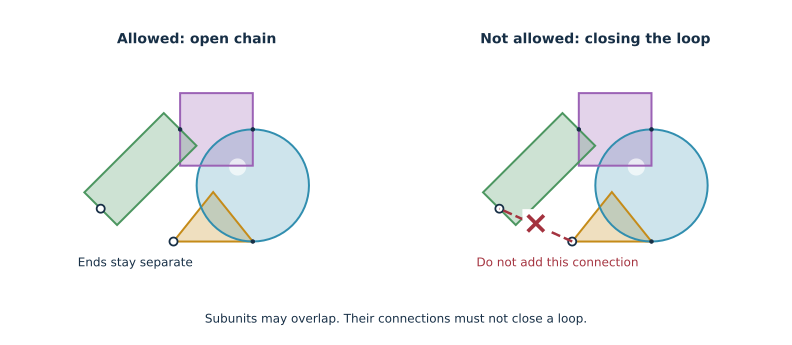
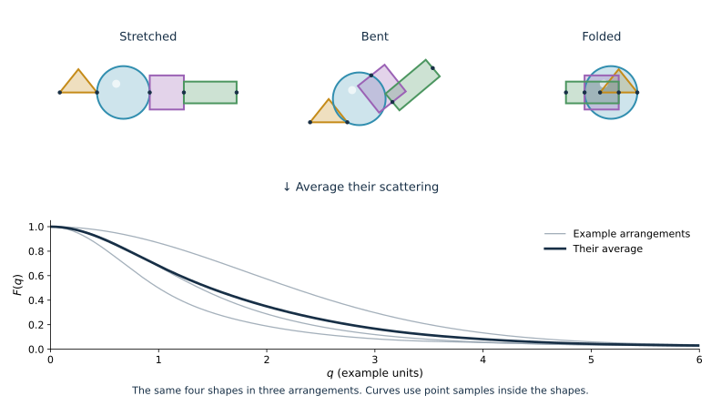
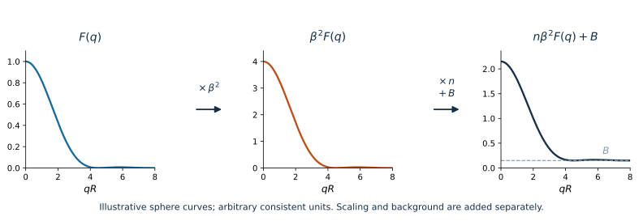

These concepts help you decide what a model represents and how to compare its
prediction with an experiment. The [Tutorials](tutorials/index.qmd) apply them
to concrete models; the [Reference Wiki](https://github.com/Tobionecenobi/pySEB/wiki)
provides detailed definitions and API documentation.

## Subunits behave like ghosts

**The subunits in a structure do not push or pull on one another.** They can
pass through one another, overlap, or sit inside one another. Their
connections stay in place.

{#fig-theory-ghost-subunits fig-alt="A triangle, blue sphere, purple square, and green rectangle are connected in that order. On the left they are spread out. On the right the triangle sits inside the sphere and the square and rectangle overlap. The shapes and connections are the same." width="100%"}

That is what **no self-interaction** means here. Connecting a polymer to a
sphere does not make the polymer avoid the sphere. Each subunit still has its
own shape and internal model: a rigid sphere remains a rigid sphere.

The subunits still scatter, and their scattered waves still interfere with
one another. The ghost comparison describes how the subunits can move
through each other; it does not remove their scattering.

## Do not close a loop

**Do not connect a structure back onto itself.** You can add subunits to a
chain or make branches, but you cannot add a connection that closes a loop.

{#fig-theory-no-loops fig-alt="Two copies of the same bent chain contain a triangle, sphere, square, and rectangle. The left chain has two free ends. On the right, a red dashed connection joins those ends, with a red cross showing that this loop is not allowed." width="100%"}

Overlapping subunits is allowed; adding that extra connection is not. This
rule concerns connections between subunits. A ring described inside a single
subunit is still possible.

## One structure, many conformations

A structure describes its connected subunits in **all the conformations
allowed by their models**. A picture shows just one of those arrangements.

Below, every chain contains the same triangle, sphere, square, and rectangle,
connected in the same order. Only their arrangement changes.

{#fig-theory-ensemble fig-alt="Three arrangements contain the same yellow triangle, blue sphere, purple square, and green rectangle. They are stretched out, bent, and overlapping. An arrow leads to their individual scattering curves and a dark average curve." width="100%"}

The calculation averages the scattering over the arrangements and directions
allowed by the model. Some arrangements can be more likely than others.
The three pictures are examples, not the full set of possible conformations.
The plotted curves illustrate an equal-weight average of these three examples.

The **unfolded** view spreads the drawing out so it is easier to read. It does
not change the scattering curve or make the subunits repel each other.

For attachment locations, start with
[What is a reference point?](tutorials/reference-points.qmd).

## Point clouds: scattering from coordinates

A point cloud describes a subunit using positions and scattering weights.
The points might represent atoms, small beads, or samples of a continuous
shape. They are scatterers, not attachment reference points. A reference
point can sit anywhere and does not add scattering by itself.

pySEB calculates scattering from the distances between the cloud's scatterers.
For an amplitude it uses distances to a chosen reference point; for a phase
factor it uses the distance between two reference points. A cloud keeps its
stored geometry when used as a subunit. To describe several conformations,
calculate their scattering separately and average the results.

`DebyeSphereCloud` gives each scatterer a position, radius, and fixed excess
scattering length. A zero radius makes it a point scatterer. `AtomicSAXSCloud`
uses atomic X-ray scattering factors and can include solvent contributions.
Coordinates alone do not specify the scattering: the weights matter too.

Start with [Scattering from a point cloud](tutorials/scattering-quantities.qmd)
for a small example you can calculate yourself.

## Hydration: water around the molecule

For a molecule in solution, the scattering model must also account for the
solvent. The molecule displaces bulk water. Water near its surface may have
a different average electron density from the bulk water; **hydration
contrast** describes that difference.

The atomic SAXS model combines three contributions before calculating their
interference: atomic scattering, subtraction of displaced bulk solvent, and
optional hydration contrast. Hydration is part of the particle's scattering,
so it cannot be represented by simply adding a constant background.

In `AtomicSAXSCloud`, hydration is off unless requested. It can be represented
by contributions at exposed atom positions or by points in a spatial shell.
Shell points sample a scattering-density model; they are not individual water
molecules. The shell geometry and weighting convention are modeling choices.

**Connecting two hydrated subunits does not rebuild their shells.** Shells
can overlap, and a surface buried by another subunit keeps its assigned
hydration contribution. This follows the same ghost-subunit assumption
described above.

See [Point Clouds and Hydration](https://github.com/Tobionecenobi/pySEB/wiki/Point-Clouds-and-Hydration)
for the model choices and limitations. The advanced
[atomic scattering and hydration tutorial](tutorials/titin-hydration.qmd)
compares solvent contributions in a worked fit.

## From form factor to measured intensity

For a worked comparison, see [Normalized form factor and scattering strength](tutorials/normalized-form-factor.qmd).

Start with the normalized form factor $F(q)$. It starts at one. Multiply by
the square of the total excess scattering length, $\beta^2$, to get the
single-particle scattering. For $\beta\ne0$,

$$
I_{\mathrm{single}}(q)=\beta^2 F(q).
$$

Next account for how many particles are present and add the background.
For identical particles in a dilute sample, with number density $n$,

$$
I(q)=n\,I_{\mathrm{single}}(q)+B(q),
$$

{#fig-theory-intensity-scaling fig-alt="Three sphere scattering plots show F starting at one, beta squared F with a changed scale, and n beta squared F plus a positive background. Arrows label the multiplications and addition; a dashed line marks the background." width="100%"}

The plots show these steps for a sphere. They use example numbers, not
experimental data. Here $R$ is the sphere radius and $B$ is a constant background.

$n$ is the number of particles per unit volume. $B(q)$ is the background.
Use consistent units for lengths, scattering lengths, and concentration.
For a uniform region, $\beta=(\rho-\rho_{\mathrm{solvent}})V$: its
scattering-length density difference from the solvent, multiplied by its volume.

A sample with different particle sizes needs a size average. Particles that
push or pull on other particles need a description of those interactions.
The measurement can also blur the curve. These effects are separate from
the simple scaling above; see the [sasmodels integration](sasmodels.qmd).

For API definitions, see [Scattering Quantities](https://github.com/Tobionecenobi/pySEB/wiki/Scattering-Quantities).
For a worked conversion using contrast, volume fraction, unit conversion, and
background, follow [Fit real contrast-variation SANS data](tutorials/fit-real-sans-data.qmd#convert-contrast-into-excess-scattering-length).
[SasView’s sphere-model definition](https://www.sasview.org/docs/user/models/sphere.html)
also shows this volume-fraction, contrast, and background convention explicitly.

## Work through the calculations

**Before starting:** Complete [Your first scattering model](tutorials/first-model.qmd)
and [What is a reference point?](tutorials/reference-points.qmd). The point-cloud
example builds F, A, and Ψ from coordinates. The distance-vector derivation
uses definite integrals to derive an analytical subunit.

| Tutorial | What you will learn |
| --- | --- |
| [Scattering from a point cloud](tutorials/scattering-quantities.qmd) | Build a weighted point cloud and get F, A, and Ψ from point-pair and reference distances |
| [Derive a subunit from distance vectors](tutorials/scattering-from-phases.qmd) | Derive a rod: form factor, midpoint amplitude, shifted-reference amplitudes, and phase factors; validate a usable subunit |

For the full theory, see the [SEB formalism](https://arxiv.org/abs/1108.1140).

## Define and extend subunits

These pages work through the scattering expressions, reference points, YAML
definitions, and validation needed to develop a subunit. Familiarity with
normalized form factors, reference points, and definite integrals is useful.

### Contribute your own subunit

Follow one thin spherical shell from its scattering material to a validated,
linkable, visualizable YAML definition. The centre, poles, and surface make
it possible to introduce each quantity separately.

| Step | Tutorial | What you will add |
| --- | --- | --- |
| 1 | [Contribute your own subunit](tutorials/contribute-subunit.qmd) | Derive the shell form factor from vectors between scattering elements |
| 2 | [Add one linkage point](tutorials/subunit-linkage-point.qmd) | Derive the reference-to-material amplitude A and validate it |
| 3 | [Add more linkage points](tutorials/subunit-multiple-references.qmd) | Add pole amplitudes and reference-pair phase factors Ψ |
| 4 | [Allow attachment anywhere on a surface](tutorials/subunit-distributed-reference.qmd) | Average over distributed linkage positions; extend validation |
| 5 | [Visualize your subunit](tutorials/subunit-visualization.qmd) | Add surface geometry and reference coordinates to YAML |

### Other model workflows

| Tutorial | What you will learn |
| --- | --- |
| [Define and validate a custom subunit](tutorials/define-custom-subunit.qmd) | Register a YAML linker and calculate a three-arm junction |
| [Add a reference to an existing subunit](tutorials/add-subunit-reference.qmd) | Derive two symmetric rod references, extend their YAML definition, and attach polymers there |
