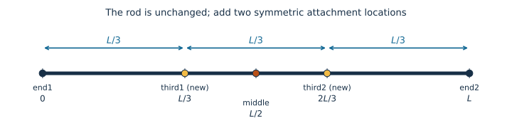

::: {.callout-note title="Before you start"}
Read [From phase sums to scattering quantities](scattering-from-phases.qmd)
for the distance-vector picture and orientation averaging. Complete
[Define and validate a custom subunit](define-custom-subunit.qmd) for YAML
registration. You should be comfortable with a simple definite integral.
Run this page from `docs/tutorials` in a repository checkout, or download the
model below into a `models` directory beside your notebook. The calculation
needs pySEB, NumPy, and Matplotlib; the final 3D view additionally needs
`pyseb[visualization]`.
:::

Suppose you want attachment points **on either side of a rod’s midpoint**.
pySEB already implements the thin rod’s scattering. We will extend a copy
with `third1` at $L/3$ and `third2` at $2L/3$, then attach a polymer at each
reference. We do not need to derive the rod form factor again.

## 1. Locate the two new references

The bundled `ThinRod` has fixed references `end1`, `middle`, and `end2`, plus
a distributed reference `contour`. Measure position $s$ from `end1`, so
$0\le s\le L$. The new references are at $s=fL$, with $f=1/3$ and
$f=2/3$. Each lies $L/6$ from `middle`, on opposite sides.

{#fig-rod-third-reference fig-alt="A uniform rod from zero to L has references end1, third1 at L/3, middle at L/2, third2 at 2L/3, and end2. The two new references are separated by L/3." width="100%"}

These are two fixed locations, not positions sampled uniformly along the
contour. The rod's geometry, scattering density, total excess scattering
length, and $F(q)$ stay unchanged.

Recall the reference-shift sketch:

{fig-alt="The midpoint fan changes to an edge fan through the phase multiplier exp of i q dot R midpoint minus R edge." width="100%"}

Here we move from `middle` to `third1` or `third2` instead of to an edge. For a rod direction
$\hat{\mathbf u}$,

$$
a_f(\mathbf q)=
e^{i\mathbf q\cdot(\mathbf R_m-\mathbf R_f)}a_m(\mathbf q),
\qquad
\mathbf R_m-\mathbf R_f=(1/2-f)L\hat{\mathbf u}.
$$

The displacement is $+L\hat{\mathbf u}/6$ for `third1` and
$-L\hat{\mathbf u}/6$ for `third2`. This phase relation
holds **before** averaging. The rotation of the rod changes both factors,
so multiplying the existing averaged amplitude by an averaged phase does not
in general give the new amplitude. We must average the new distances.

## 2. Derive their shared amplitude

A uniform rod gives normalized weight $ds/L$ to each scattering element.
Its distance from the new reference is $|s-fL|$. Averaging over 3D rod
orientations converts its exponential phase into a sinc:

$$
A_f(q)=\frac1L\int_0^L
\operatorname{sinc}\!\left(q|s-fL|\right)\,ds,
\qquad \operatorname{sinc}(x)=\frac{\sin x}{x}.
$$

Split the integral at the reference. The two sides have lengths $fL$ and
$(1-f)L$:

$$
A_f(q)=\frac1L\left[
\int_0^{fL}\operatorname{sinc}(qu)\,du+
\int_0^{(1-f)L}\operatorname{sinc}(qu)\,du\right].
$$

Define $x=qL$ and $\operatorname{Si}(x)=\int_0^x\sin(t)/t\,dt$. Then

$$
A_f(q)=\frac{\operatorname{Si}(fx)+\operatorname{Si}((1-f)x)}{x}
=f\,\mathrm{six}(fx)+(1-f)\,\mathrm{six}((1-f)x),
$$

where pySEB's `six(x)` means $\operatorname{Si}(x)/x$, with limit one at zero.
It is different from `sinc(x)`.
Reflection about the midpoint exchanges the two lengths, so both references
have the same averaged amplitude:

$$
\boxed{A_{third1}(q)=A_{third2}(q)=\frac13\mathrm{six}(x/3)
+\frac23\mathrm{six}(2x/3).}
$$

As checks on the derivation, $f=0$ or $1$ recovers the existing endpoint
amplitude `six(x)`, and $f=1/2$ recovers the midpoint amplitude `six(x/2)`.
The weighted expression also gives $A_f(0)=1$ without dividing by zero.

## 3. Derive phase factors and distance measures

Supply phase factors from each new reference to **every existing reference**,
and between the two new references. Let $x=qL$ as above:

| Existing reference | Phase from `third1` | Phase from `third2` |
| --- | --- | --- |
| `end1` | $\operatorname{sinc}(x/3)$ | $\operatorname{sinc}(2x/3)$ |
| `end2` | $\operatorname{sinc}(2x/3)$ | $\operatorname{sinc}(x/3)$ |
| `middle` | $\operatorname{sinc}(x/6)$ | $\operatorname{sinc}(x/6)$ |
| `contour` | $A_{third1}(q)$ | $A_{third2}(q)$ |

Equal amplitudes do **not** make the two references interchangeable in a link:
their distances to the named endpoints are reversed. Their mutual phase is

$$
\Psi_{third1,third2}(q)=\operatorname{sinc}(x/3),
$$

because their separation is $L/3$.

The contour case needs an average over its sampled position. Its integral
is exactly the amplitude integral above, because the rod's scattering density
and contour sampling are both uniform. Do not use a single mean separation.
A fixed reference paired with itself has phase one.

For the reference-to-scatterer mean-square distance,

$$
\left\langle (s-fL)^2\right\rangle
=\frac1L\int_0^L(s-fL)^2\,ds
=L^2(f^2-f+1/3).
$$

At both $f=1/3$ and $f=2/3$, this is $L^2/9$. The full new distance table is:

| Reference | To `end1` | To `end2` | To `middle` | To `contour` |
| --- | --- | --- | --- | --- |
| `third1` | $L^2/9$ | $4L^2/9$ | $L^2/36$ | $L^2/9$ |
| `third2` | $4L^2/9$ | $L^2/9$ | $L^2/36$ | $L^2/9$ |

The mean-square distance between `third1` and `third2` is $L^2/9$.
The original radius of gyration remains $R_g^2=L^2/12$.
Both amplitudes have the small-q expansion $1-q^2L^2/54+O(q^4)$.

## 4. Extend the YAML definition

The downloadable model copies the bundled `ThinRod` definition and retains
its original equations, references, validation cases, and citation metadata.
It uses a new ID, `tutorial/OffsetReferenceRod`, and API name
`OffsetReferenceRod`, so it can be registered alongside the bundled model.

[Download OffsetReferenceRod.pyseb.yaml](models/OffsetReferenceRod.pyseb.yaml){download="OffsetReferenceRod.pyseb.yaml"}

The additions are:

- Add `third1` and `third2` to the specific references, with the shared amplitude `Fthird`.
- Add eight phase factors to existing references, plus the mutual phase, and their mean-square distances.
- Add both references to `sizes.reference_to_scatterer`.
- Add visual references at contour fractions $1/3$ and $2/3$ and numerical validation cases.

The existing form factor and all existing reference expressions are retained.
This file is a complete model definition; YAML does not inherit from the
bundled model or patch it at registration time.

::: {.callout-note title="Coordinate versus fraction"}
The bundled rod's visual curve uses coordinates from $-L/2$ to $L/2$.
Contour fractions $1/3$ and $2/3$ therefore place `third1` and `third2` at
$-L/6$ and $+L/6$ on that visual axis. Their distances from `end1` are still
$L/3$ and $2L/3$. The `fraction` field is a fraction
of the complete curve, not a coordinate in length units.
:::

::: {.callout-note collapse="true" title="Complete model definition"}
```yaml

```
:::

## 5. Validate against independent distance integrals

The file includes zero-angle, nonzero-q, and size checks. Validate it before
registering it, then create an isolated custom rod and a bundled rod for
comparison. Both use the tag `rod` and the same physical parameters.

```{python}
from pathlib import Path
import matplotlib.pyplot as plt
import numpy as np
from numpy.polynomial.legendre import leggauss
import pyseb

model_path = Path("models/OffsetReferenceRod.pyseb.yaml").resolve()
report = pyseb.validate_subunit_file(str(model_path))
assert report.ok, [failure.message for failure in report.failures]
print(f"Passed {report.case_count} model validation cases")
world = pyseb.World("NewRodReferenceTutorial")
world.register_subunit_file(str(model_path))
rod_graph = world.Add("OffsetReferenceRod", "rod", "rod")
world.Add("ThinRod", "original", "rod")
parameters = {"L_rod": 9.0, "beta_rod": 1.0}
q = np.linspace(0.0, 2.5, 160)
```

Use Gauss–Legendre quadrature to evaluate the distance integrals directly,
without `six`. NumPy's sinc has a factor of $\pi$ in its definition, so divide
its argument by $\pi$.

```{python}
nodes, weights = leggauss(100)
t = (nodes + 1) / 2  # position as fraction of L
weights = weights / 2
x = q * parameters["L_rod"]
amplitudes = {}
for new_reference, f in (("third1", 1/3), ("third2", 2/3)):
    quadrature_amplitude = np.sinc(x[:, None] * abs(t - f) / np.pi) @ weights
    native = np.asarray(world.EvaluateFormFactorAmplitude(
        f"rod.{new_reference}", parameters, q.tolist()))
    np.testing.assert_allclose(native, quadrature_amplitude, rtol=1e-10, atol=1e-12)
    amplitudes[new_reference] = native

    for reference, fraction in (("end1", 0.0), ("end2", 1.0), ("middle", 0.5)):
        phase = world.EvaluatePhaseFactor(
            f"rod.{new_reference}", f"rod.{reference}", parameters, q.tolist())
        expected = np.sinc(x * abs(f - fraction) / np.pi)
        np.testing.assert_allclose(phase, expected, rtol=1e-10, atol=1e-12)
        distance2 = world.EvaluateSMSDRef2Ref(
            f"rod.{new_reference}", f"rod.{reference}", parameters)
        assert np.isclose(distance2, (parameters["L_rod"] * (f-fraction))**2)

    contour_phase = world.EvaluatePhaseFactor(
        f"rod.{new_reference}", "rod.contour", parameters, q.tolist())
    np.testing.assert_allclose(contour_phase, quadrature_amplitude,
                               rtol=1e-10, atol=1e-12)
    assert np.isclose(world.EvaluateSMSDRef2Scat(
        f"rod.{new_reference}", parameters), 9.0)
    assert np.isclose(world.EvaluateSMSDRef2Ref(
        f"rod.{new_reference}", "rod.contour", parameters), 9.0)

np.testing.assert_allclose(amplitudes["third1"], amplitudes["third2"])
mutual_phase = world.EvaluatePhaseFactor(
    "rod.third1", "rod.third2", parameters, q.tolist())
np.testing.assert_allclose(mutual_phase, np.sinc(x / (3*np.pi)), atol=1e-12)
assert np.isclose(world.EvaluateSMSDRef2Ref(
    "rod.third1", "rod.third2", parameters), 9.0)
```

Finally compare with the original implementation. Adding references should
leave the form factor, radius of gyration, and old amplitudes unchanged.

```{python}
for quantity in ("EvaluateFormFactor", "EvaluateRadiusOfGyration2"):
    method = getattr(world, quantity)
    arguments = (parameters, q.tolist()) if quantity == "EvaluateFormFactor" else (parameters,)
    np.testing.assert_allclose(method("rod", *arguments),
                               method("original", *arguments))
for reference in ("end1", "middle", "end2", "contour"):
    np.testing.assert_allclose(
        world.EvaluateFormFactorAmplitude(f"rod.{reference}", parameters, q.tolist()),
        world.EvaluateFormFactorAmplitude(f"original.{reference}", parameters, q.tolist()),
    )
print("New reference integrals and original rod quantities verified.")

plt.plot(q, amplitudes["third1"], label="third1")
plt.plot(q, amplitudes["third2"], "--", label="third2 (same amplitude)")
for reference in ("end1", "middle"):
    plt.plot(q, world.EvaluateFormFactorAmplitude(
        f"rod.{reference}", parameters, q.tolist()), label=reference)
plt.xlabel(r"$q$ [nm$^{-1}$]")
plt.ylabel(r"$A(q)$")
plt.legend(title="Reference")
plt.show()
```

## 6. Attach a polymer at each new reference

Now use both references as you would built-in endpoints. Attach two polymers
with a shared tag, so they have the same size and scattering weight. Their
cross term uses the new `third1`–`third2` phase factor. The separate `original`
rod remains isolated.

```{python}
for index in (1, 2):
    world.Link("GaussianPolymer", f"chain{index}.end1",
               f"rod.third{index}", "chain")
world.Add(rod_graph, "branchedRod")
assembly_parameters = dict(parameters, beta_chain=0.5, Rg_chain=1.5)
assembly_F = world.EvaluateFormFactor("branchedRod", assembly_parameters, q.tolist())
assert np.all(np.isfinite(assembly_F))
assert np.isclose(assembly_F[0], 1.0)
plt.plot(q, assembly_F)
plt.xlabel(r"$q$ [nm$^{-1}$]")
plt.ylabel(r"$F_{rod+chains}(q)$")
plt.show()
```

The geometry definition lets the optional viewer place the two junctions
on opposite sides of `middle`. The polymers are illustrative realizations; scattering averages over its
conformations and orientations.

```{python}
_ = pyseb.visualize(world, "branchedRod", assembly_parameters, height=440, layouts=["random", "readable"])
```

## Try another location

On paper, move the pair to $f=1/4$ and $f=3/4$. Derive their shared amplitude,
phase factors to all existing references, mutual phase, and mean-square
distances. Then change the YAML expressions and visual fractions together,
update the nonzero-q validation cases, and repeat the checks.
At $f=1/2$, verify that every new quantity recovers the existing midpoint
result. Merely moving the visualization marker does not change the scattering
or attachment equations.

Continue to [Save, reload, and visualize a model](save-load-model.qmd) to
preserve a world that uses your external subunit definition. The
[file-defined subunit reference](../file-defined-subunits.qmd) documents the
complete schema.
