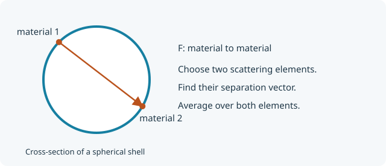

::: {.callout-note title="Before you start"}
Read [Normalized form factor and scattering strength](normalized-form-factor.qmd)
and [What is a reference point?](reference-points.qmd). This sequence uses pySEB,
NumPy, and Matplotlib. Each page runs independently with its downloadable YAML
in a `models` folder beside the notebook.
:::

A new subunit starts with a description of **where its scattering material is**.
We will derive a uniform, rigid, infinitesimally thin spherical shell of radius
$R>0$. There is material on the surface and none in the interior. It is a
simple model of a hollow particle, without a finite wall thickness.

This shape already exists as `ThinSphericalShell`. Rebuilding it under our own
name gives us simple equations to check while learning the YAML format.
A shell is useful here because its centre, poles, and entire surface give
three different ways to define linkage locations.

## The five steps

| Step | What we want | What we supply |
| --- | --- | --- |
| 1. This page | Scattering from the isolated shell | Form factor $F(q)$ |
| 2. [One linkage point](subunit-linkage-point.qmd) | Attach another subunit at the centre | Form-factor amplitude $A_{center}(q)$ |
| 3. [More linkage points](subunit-multiple-references.qmd) | Attach at either pole as well | An $A$ for each reference and a phase factor $\Psi$ for each pair |
| 4. [A distributed surface](subunit-distributed-reference.qmd) | Attach anywhere on the shell | Averages over surface positions |
| 5. [Visualization](subunit-visualization.qmd) | Display the shell and its attachments | Geometry and reference coordinates in YAML |

We keep the same shape throughout. Each downloadable file is a complete
snapshot, replacing the previous one. They share `api_name: ContributorShell`;
register **one stage per World**, as the examples do.

## Draw the vectors between scattering elements

{fig-alt="Cross-section of a hollow spherical shell, with two points on its boundary and a vector from one scattering element to the other." width="620"}

Write a surface position as $\mathbf r=R\hat{\mathbf n}$, where
$\hat{\mathbf n}$ is a unit vector. For a uniform shell the normalized
scattering measure is $d\Omega/(4\pi)$, with
$d\Omega=\sin\theta\,d\theta\,d\phi$. The total excess scattering length
$\beta$ is handled separately; it cancels from the normalized factor.

The form factor averages over **two scattering elements** and orientations:

$$
F(q)=\int\frac{d\Omega}{4\pi}\int\frac{d\Omega'}{4\pi}
\operatorname{sinc}\!\left(q|R\hat{\mathbf n}-R\hat{\mathbf n}'|\right),
\qquad \operatorname{sinc}(x)=\frac{\sin x}{x},\quad\operatorname{sinc}(0)=1.
$$

Here `sinc` is the orientation average of $e^{i\mathbf q\cdot\mathbf d}$
for a fixed vector $\mathbf d$. The shell is rigid, so it has no internal
conformations to average over.

Spherical symmetry lets us fix the first element at the north pole. With
$\mu=\hat{\mathbf n}\cdot\hat{\mathbf n}'$, the pair distance is
$R\sqrt{2-2\mu}$. Set $x=qR$:

$$
F(q)=\frac12\int_{-1}^{1}
\operatorname{sinc}\!\left(x\sqrt{2-2\mu}\right)d\mu
=\frac{1-\cos(2x)}{2x^2}
=\boxed{\operatorname{sinc}^2(x)}.
$$

The shell's centre of scattering is its geometric centre and every scattering
element lies at distance $R$, so $R_g^2=R^2$.

## Put the result in YAML

These are the form-factor and size entries:

```yaml
parameters:
  R:
    unit: length
    description: Shell radius (positive)
variables:
  x: "q * R"
definitions:
  shell: "sinc(x)^2"
expressions:
  form_factor: shell
sizes:
  radius_of_gyration_squared: "R^2"
```

This excerpt is part of a larger file. pySEB currently requires at least one
reference even for an isolated subunit. The complete starting file therefore
also declares `center` and its amplitude `sinc(x)`. The next page derives
that expression and explains how it enables linking. No other subunit is
attached on this page.

Use `sinc(x)` rather than `sin(x)/x` so the value at zero is well defined.

## Add validation before using the model

Include both a zero-angle check and a nonzero-q check. At $R=2$ and $q=0.5$,
$x=1$ and $F=\sin^2(1)=0.7080734182735712$:

```yaml
validation:
  absolute_tolerance: 1.0e-10
  relative_tolerance: 1.0e-8
  cases:
    - name: forward form factor
      quantity: form_factor
      parameters: {R: 2.0}
      q: 0.0
      expected: 1.0
    - name: form factor at qR=1
      quantity: form_factor
      parameters: {R: 2.0}
      q: 0.5
      expected: 0.7080734182735712
    - name: shell radius of gyration squared
      quantity: radius_of_gyration_squared
      parameters: {R: 2.0}
      expected: 4.0
```

Validation cases use the file's parameter name `R`. Once instantiated as
`shell`, the World uses `R_shell` and the scattering weight `beta_shell`.

[Download the complete stage 1 YAML](models/ContributorShell1.pyseb.yaml){download="ContributorShell1.pyseb.yaml"}

<details>
<summary>Complete YAML at this stage</summary>

```yaml

```

</details>

## Validate, register, and calculate

```{python}
from pathlib import Path

import matplotlib.pyplot as plt
import numpy as np
import pyseb

model_path = Path("models/ContributorShell1.pyseb.yaml").resolve()
report = pyseb.validate_subunit_file(str(model_path))
assert report.ok, report.failures
print(f"Passed {report.case_count} YAML validation cases")

world = pyseb.World("ShellStage1")
world.register_subunit_file(str(model_path))
shell_graph = world.Add("ContributorShell", "shell")
parameters = {"R_shell": 2.0, "beta_shell": 1.0}
q = np.linspace(0.0, 3.0, 180)  # nm^-1
```

Check the closed form against the original distance integral, evaluated by
Gauss–Legendre quadrature. NumPy's `sinc(z)` means $\sin(\pi z)/(\pi z)$,
so its argument needs a factor $1/\pi$:

```{python}
from numpy.polynomial.legendre import leggauss

mu, weights = leggauss(96)
pair_distances = parameters["R_shell"] * np.sqrt(2.0 - 2.0 * mu)
F_direct = np.sinc(q[:, None] * pair_distances / np.pi) @ (weights / 2)
F = np.asarray(world.EvaluateFormFactor("shell", parameters, q.tolist()))
np.testing.assert_allclose(F, F_direct, rtol=1e-9, atol=1e-11)

plt.plot(q, F, label="YAML form factor")
plt.plot(q[::9], F_direct[::9], "o", label="Direct pair-distance integral")
plt.xlabel(r"$q$ [nm$^{-1}$]")
plt.ylabel(r"$F(q)$")
plt.legend()
plt.show()
```

The check compares two ways of doing the calculation. It can catch an error
that a normalization check alone would miss. This special spherical shell has
$F=A_{center}^2$; squaring an already averaged amplitude is **not** a general
rule for other subunits.

## Next

[Add one linkage point](subunit-linkage-point.qmd).
