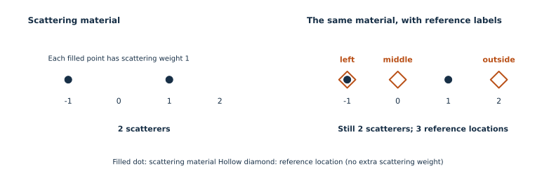

::: {.callout-note title="Before you start"}
Read [Introduction to pySEB](introduction.qmd). No scattering derivation or
calculus is needed. To run the short Python example, use the environment from
[Your first scattering model](first-model.qmd), with pySEB and NumPy installed.
:::

A **scatterer** contributes to the scattering signal. A **reference point**
is a named location used to measure distances or connect subunits.
Naming a reference point does not add any scattering material.

## 1. A location and a scatterer are different things

Imagine two point scatterers at $x=-1$ and $x=1$. Both have scattering
weight one. We can name three reference locations:

| Reference | Coordinate | Is there a scatterer there? |
| --- | --- | --- |
| `left` | $x=-1$ | Yes: it coincides with the first scatterer |
| `middle` | $x=0$ | No: it lies between the scatterers |
| `outside` | $x=2$ | No: it lies outside the scattering material |

{#fig-reference-points-vs-scatterers fig-alt="The left panel has two filled scattering points at minus one and one. The right panel has the same two filled points, plus hollow diamond references at minus one, zero, and two. The reference at minus one surrounds an existing scattering point without adding another." width="100%"}

The cloud still has **two scatterers**, regardless of how many reference
locations we name. `left` has two roles at the same coordinate: scattering
material is already there, and we have also given that location a reference
name. Naming it does not count the scatterer twice.

A reference carries no scattering weight of its own. The marker used to draw
it is a label in the visualization, not an extra bead in the model.

## 2. References belong to a subunit

The two-point cloud is one subunit. Its reference names identify locations
relative to that cloud, and move with it when the cloud is placed in a larger
structure. In pySEB, a reference path combines the instance name and the
reference name: `cloud.middle` means the `middle` reference of the instance
called `cloud`.

Other subunits expose references suited to their geometry:

| Subunit | Reference examples | What they identify |
| --- | --- | --- |
| Solid sphere | `center`, `surface` | Its centre or a location sampled on its surface |
| Thin rod | `end1`, `middle`, `end2` | Its two endpoints and midpoint |
| Gaussian polymer | `end1`, `end2`, `contour` | Its endpoints or a location sampled along its contour |

A **fixed reference** identifies a particular location on the subunit.
For a flexible polymer, even a fixed endpoint moves as the chain changes
conformation. Fixed does not mean fixed in the laboratory.

A **distributed reference** specifies how an attachment location is sampled,
such as uniformly over a sphere surface. `surface` names that distribution;
it does not name one permanent point or add scatterers across the surface.
The scattering calculation averages over the specified locations.

## 3. Try it: add references without adding scatterers

Construct two copies of the same scattering material. Add reference labels
to only the second copy:

```{python}
import numpy as np
import pyseb

scatterers = [
    pyseb.SphereScatterer(-1.0, 0.0, 0.0, 0.0, 1.0),
    pyseb.SphereScatterer( 1.0, 0.0, 0.0, 0.0, 1.0),
]
# Arguments are x, y, z, radius, scattering weight. Radius zero means a point.
plain = pyseb.DebyeSphereCloud(scatterers)
labelled = pyseb.DebyeSphereCloud(scatterers)
labelled.addReferencePoint("left", -1.0, 0.0, 0.0)
labelled.addReferencePoint("middle", 0.0, 0.0, 0.0)
labelled.addReferencePoint("outside", 2.0, 0.0, 0.0)

assert plain.scattererCount() == labelled.scattererCount() == 2
print("Both clouds still contain two scatterers.")
```

`SphereScatterer` supplies the scattering material. `addReferencePoint`
supplies a name and coordinate. These are separate operations.

Their isolated form factors must be identical because the scatterers and
their weights are identical:

```{python}
world = pyseb.World("ReferencePointsTutorial")
world.Add(plain, "plain")
graph = world.Add(labelled, "labelled")
q = np.linspace(0.0, 3.0, 80)

F_plain = np.asarray(world.EvaluateFormFactor("plain", {}, q.tolist()))
F_labelled = np.asarray(world.EvaluateFormFactor("labelled", {}, q.tolist()))
np.testing.assert_allclose(F_plain, F_labelled, rtol=1e-12, atol=1e-12)
print("Adding reference labels leaves the cloud's form factor unchanged.")
```

## 4. Why do we need references?

They supply the starting or ending locations for two scattering quantities:

| Quantity | Which locations does it use? |
| --- | --- |
| Form factor $F$ | Scatterer to scatterer; no reference is needed |
| Form-factor amplitude $A$ | One chosen reference to every scatterer |
| Phase factor $\Psi$ | One reference to another reference |

Choosing `middle` or `outside` gives different reference-to-scatterer
distances, and therefore generally different amplitudes. The phase factor
between them uses their separation. Neither calculation requires scattering
material at the reference locations.

Moving only `outside` changes its amplitude and its phase factors to other
references. It leaves the isolated cloud's form factor unchanged because no
scatterer has moved. The next two tutorials show how to calculate these factors.

## 5. Connect subunits through their references

A link joins reference locations, rather than searching for the nearest
scatterers. For example, a polymer endpoint can connect to `labelled.outside`
even though no cloud scatterer occupies that location.

```{python}
world.Link("GaussianPolymer", "chain.end1", "labelled.outside")
world.Add(graph, "cloudWithChain")
```

The endpoint and the chosen cloud reference coincide in each linked
realization. The added polymer supplies its own scattering material; the
link itself adds no extra scatterer. Its conformations and allowed relative
orientations are handled by the subunit and linking model.

Changing an attachment reference can change the scattering of the **complete
assembly**, because it changes the distances between material in different
subunits. This is consistent with the cloud's **own** form factor staying
unchanged.

## Continue

- [Connect two subunits in a diblock](diblock-copolymer.qmd) to use references in a composite model.
- [Scattering from a point cloud](scattering-quantities.qmd) to calculate $F$, $A$, and $\Psi$ from coordinates.
- [Derive a subunit from distance vectors](scattering-from-phases.qmd) to derive the same quantities for a continuous shape.
