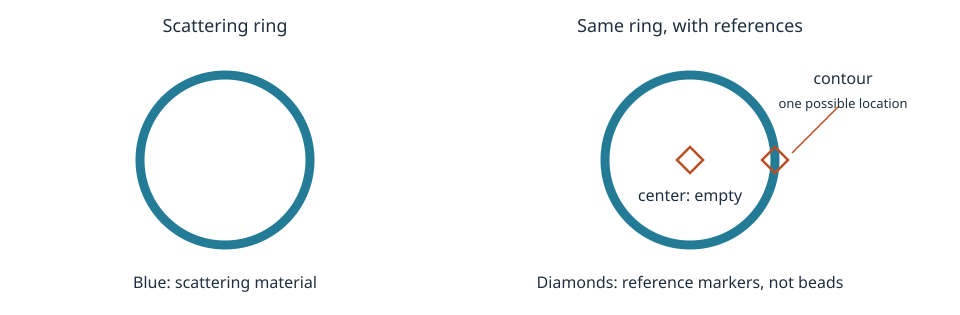

::: {.callout-note title="Before you start"}
Complete [Diblock copolymer](diblock-copolymer.qmd) first. This page builds on
its `Add` and `Link` calls to explore different attachment locations.
:::

A **reference point** tells SEB where a subunit can connect to another subunit,
or from where to measure distances. Defining one adds no scattering material.
It can lie on the material or in an empty region.

## 1. Start with a ring

A thin ring has scattering material along its circumference and an empty
centre. pySEB provides this analytical model as `ThinCircle`, which we will
use in the two examples below.

The ring comes with two references:

| Reference | Meaning | Is scattering material there? |
| --- | --- | --- |
| `ring.center` | The fixed centre of the ring | No |
| `ring.contour` | A location sampled uniformly along the ring | Yes |

{#fig-reference-points-ring fig-alt="Two continuous rings. The second has a hollow diamond at its empty centre and another on its circumference. The contour diamond illustrates one possible attachment location sampled along the ring. Neither marker adds material." width="100%"}

**A reference is allowed to coincide with scattering material.** The material
contributes scattering; the reference identifies a location. These are two
roles at the same position, rather than two contributions to the signal.
Likewise, the `center` reference does not fill the hole in the ring.

The hollow diamonds in the diagram are labels, not extra beads. The two
panels contain exactly the same scattering ring.

## 2. Choose where to attach a polymer

There are two different models we could build:

- Connect the polymer endpoint to the **empty centre**.
- Connect it to a location on the **scattering ring**.

Both examples use the same ring radius, polymer size, and scattering weights:

```{python}
import pyseb

parameters = {
    "R_ring": 10.0,
    "beta_ring": 1.0,
    "Rg_chain": 5.0,
    "beta_chain": 1.0,
}
```

### Attach at the empty centre

The `Link` call places `chain.end1` at `ring.center`. Run the code to build
and view the complete ring–polymer structure:

```{python}
center_linked = pyseb.World("CenterLinkedRing")
graph = center_linked.Add("ThinCircle", "ring")
center_linked.Link("GaussianPolymer", "chain.end1", "ring.center")
center_linked.Add(graph, "assembly")

center_view = pyseb.visualize(center_linked, "assembly", parameters, height=420)
```

The chain starts in the **empty middle** of the ring. The ring still contains
no material at its centre; the visible chain belongs to the added polymer.
Drag the view to see the attachment from another direction.

### Attach on the scattering ring

Now build a second structure, with the endpoint linked to `ring.contour#join`:

```{python}
contour_linked = pyseb.World("ContourLinkedRing")
graph = contour_linked.Add("ThinCircle", "ring")
contour_linked.Link("GaussianPolymer", "chain.end1", "ring.contour#join")
contour_linked.Add(graph, "assembly")

contour_view = pyseb.visualize(contour_linked, "assembly", parameters, height=420)
```

This time the chain starts **on the circumference**, where ring material is
present. `contour` samples an attachment location uniformly along the ring;
`#join` names this particular use of that distributed reference. It adds no
scatterer.

Each viewer shows one representative polymer conformation. In the second
view it also shows one sampled contour attachment. The scattering model
averages over these possibilities; the pictures are not unique structures
inferred from data. Reference markers can be shown using the settings button
inside each viewer.

In each realization, the two linked reference locations coincide. The added
polymer supplies its own scattering material. The link itself supplies none.
These are freely jointed SEB models; a link does not impose a fixed relative
orientation or automatically introduce a physical connector across the hole.

## 3. Does the attachment change the scattering?

Use the same parameters to calculate the scattering of both structures:

```{python}
import numpy as np

q = np.linspace(0.0, 0.8, 150)

center_curve = center_linked.EvaluateFormFactor("assembly", parameters, q.tolist())
contour_curve = contour_linked.EvaluateFormFactor("assembly", parameters, q.tolist())
```

The two curves differ because the attachment changes the distances between
the polymer and ring material. It does not change the ring's own geometry
or scattering weight.

```{python}
#| code-fold: true
#| code-summary: "Compare the two attachment choices"
import matplotlib.pyplot as plt

fig, ax = plt.subplots(figsize=(7, 4))
ax.plot(q, center_curve, label="Chain attached at the centre")
ax.plot(q, contour_curve, label="Chain attached along the contour")
ax.set(xlabel=r"$q$ [Å$^{-1}$]", ylabel="Normalized form factor")
ax.legend()
fig.tight_layout()
plt.show()
```

A reference is therefore more than a marker in a picture: **choosing the
attachment changes the composite model**. But merely defining references
on an isolated ring does not change its scattering.

## 4. Recognize references in other subunits

| Subunit | Fixed reference examples | Distributed reference examples |
| --- | --- | --- |
| Thin circle | `center` | `contour` |
| Solid sphere | `center` | `surface` |
| Thin rod | `end1`, `middle`, `end2` | `contour` |
| Gaussian polymer | `end1`, `end2`, `middle` | `contour` |

A fixed reference identifies a particular location on its subunit. A polymer
endpoint is fixed in this sense even though it moves as the polymer changes
conformation. A distributed reference describes how a location is sampled.
In either case, the scattering calculation averages over the model's allowed
positions and conformations.

## Continue

[Explore building blocks](custom-yaml-workflow.qmd) to see the available subunit
geometries and their references.

- [Rod–coil copolymer](rod-coil.qmd) to connect rigid and flexible subunits.
- [Contribute your own subunit](contribute-subunit.qmd) to introduce F, A, and Ψ one step at a time.
- [Scattering from a point cloud](scattering-quantities.qmd) to calculate form factors, amplitudes, and phase factors from coordinates.
- [Derive a subunit from distance vectors](scattering-from-phases.qmd) for the mathematical definitions behind those quantities.
