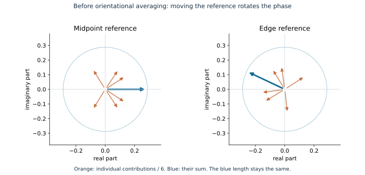
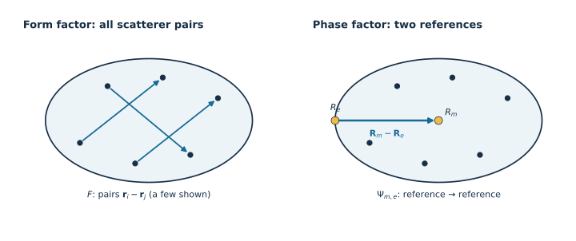

::: {.callout-note title="Before you start"}
Read [Introduction to pySEB](introduction.qmd) and
[Your first scattering model](first-model.qmd) first. You should know what
$q$ and a reference point mean. Use that Python environment with NumPy and
Matplotlib installed. No PDB files or optional 3D viewer are needed here.
:::

The three quantities use three kinds of distance: **scatterer to scatterer**,
**reference to scatterer**, and **reference to reference**. We will draw those
distances, turn them into phase sums, and check our calculations with pySEB.

## 1. Draw the vectors before writing the equations

{#fig-scattering-distance-vectors fig-alt="The midpoint fan on the left connects to the edge fan on the right through an arrow labelled multiply by exp of i q dot R midpoint minus R edge, before averaging." width="100%"}

The orange fans are the geometric picture of a form-factor amplitude. Each
arrow starts at the chosen reference and ends at a scatterer. Moving the
reference from the midpoint $\mathbf R_m$ to the edge $\mathbf R_e$ changes
all those arrows. **The object itself has not moved or changed shape.**

The connecting arrow shows the corresponding phase change explicitly:

$$
a_e(\mathbf q)=
\underbrace{e^{i\mathbf q\cdot(\mathbf R_m-\mathbf R_e)}}_{\text{move the reference from midpoint to edge}}
a_m(\mathbf q).
$$

The position difference sits **inside the exponent**. This relation applies
before orientational averaging, as the arrow label indicates; the averaged
quantities are introduced in Step 3.

The outline is only a guide: our example contains six discrete point
scatterers, not a uniformly filled ellipse. The two reference points need
not scatter, and a reference need not be the centre of scattering.

## 2. Convert each arrow into a complex phase

A displacement $\mathbf d$ contributes

$$
e^{i\mathbf q\cdot\mathbf d}
=\cos(\mathbf q\cdot\mathbf d)+i\sin(\mathbf q\cdot\mathbf d).
$$

Think of this as a unit arrow in the complex plane. Its angle depends on the
projection of $\mathbf d$ along the scattering vector $\mathbf q$.
Here $i^2=-1$; $\mathbf q\cdot\mathbf d$ is dimensionless.

For scatterer $j$ at $\mathbf r_j$, measured from reference
$\mathbf R_\alpha$, that phase is

$$
\underbrace{e^{i\mathbf q\cdot\mathbf r_j}}_{\text{scatterer phase}}
\underbrace{e^{-i\mathbf q\cdot\mathbf R_\alpha}}_{\text{reference phase}}
= e^{i\mathbf q\cdot(\mathbf r_j-\mathbf R_\alpha)}.
$$

**Subtract the positions inside the exponent; multiply the two exponentials.**
Subtracting the exponentials would describe a different quantity.

Let $b_j$ be the real excess scattering length of point $j$ and
$\beta=\sum_j b_j\ne0$. The normalized amplitude for **one orientation** is

$$
a_\alpha(\mathbf q)=\frac{1}{\beta}
\sum_j b_j e^{i\mathbf q\cdot(\mathbf r_j-\mathbf R_\alpha)}.
$$

This adds the complex contributions from every arrow in one orange fan.
For a continuous density, replace the weighted point sum with a volume
integral. We will keep the point sum so every calculation can be checked.

### What happens when the reference moves?

If $\mathbf R_{\mathrm{new}}=\mathbf R_{\mathrm{old}}+\boldsymbol\Delta$,

$$
a_{\mathrm{new}}(\mathbf q)
=e^{-i\mathbf q\cdot\boldsymbol\Delta}\,a_{\mathrm{old}}(\mathbf q).
$$

Every contribution rotates by the same phase. The length of their sum stays
the same, so $|a_{\mathrm{new}}|^2=|a_{\mathrm{old}}|^2$ for each orientation.

{#fig-reference-phase fig-alt="Two complex-plane plots show six orange phase contributions and their blue sum. Shifting the reference rotates every contribution and the resultant without changing the resultant length." width="100%"}

The figure uses $\mathbf q=(0.9,0.5,0)$ nm$^{-1}$ and the coordinates below.
These complex-plane arrows represent **phases**, whereas the arrows in the
first figure represent **distances in the object**.

## 3. Average to obtain the three pySEB quantities

For an isotropic solution, average over all object orientations. Flexible
objects also require an average over their conformations. Angle brackets
below denote these averages; all three quantities are normalized to one at
$q=0$ when $\beta\ne0$.

| Quantity | Definition | Distances involved |
| --- | --- | --- |
| Form factor | $F(q)=\langle |a_\alpha(\mathbf q)|^2\rangle$ | All scatterer pairs |
| Form-factor amplitude | $A_\alpha(q)=\langle a_\alpha(\mathbf q)\rangle$ | One reference to every scatterer |
| Phase factor | $\Psi_{\alpha\omega}(q)=\langle e^{i\mathbf q\cdot(\mathbf R_\alpha-\mathbf R_\omega)}\rangle$ | Two references |

{#fig-scattering-pair-vectors fig-alt="Two adjacent panels show several scatterer-pair vectors for the form factor and the edge-to-midpoint reference vector for the phase factor." width="100%"}

$F$ is independent of the reference because the reference phases cancel when
multiplying $a_\alpha$ by its complex conjugate. $A_\alpha$ generally changes
with the reference: averaging differently rotated contributions changes the
result. $\Psi$ contains no scatterer sum or scattering weights.

::: {.callout-important title="Average in the right order"}
The form factor is $\langle |a|^2\rangle$, **not**
$|\langle a\rangle|^2$. In general, $F(q)\ne|A_\alpha(q)|^2$.
Likewise, the orientation-dependent phase and amplitude are correlated, so
one cannot generally obtain a shifted, averaged amplitude by multiplying
$A_{\mathrm{old}}(q)$ by $\Psi_{\mathrm{new,old}}(q)$.
:::

For a fixed distance $d$, averaging the exponential over 3D orientations gives

$$
\left\langle e^{i\mathbf q\cdot\mathbf d}\right\rangle
=\frac12\int_{-1}^{1}e^{iqd\mu}\,d\mu
=\frac{\sin(qd)}{qd}=\operatorname{sinc}(qd),
\qquad \operatorname{sinc}(0)=1.
$$

Thus for our rigid point cloud the calculation becomes

$$
\begin{aligned}
F(q)&=\frac{1}{\beta^2}\sum_{j,k}b_jb_k\,
\operatorname{sinc}\!\left(q|\mathbf r_j-\mathbf r_k|\right),\\
A_\alpha(q)&=\frac{1}{\beta}\sum_jb_j\,
\operatorname{sinc}\!\left(q|\mathbf r_j-\mathbf R_\alpha|\right),\\
\Psi_{\alpha\omega}(q)&=
\operatorname{sinc}\!\left(q|\mathbf R_\alpha-\mathbf R_\omega|\right).
\end{aligned}
$$

Include the $j=k$ self terms in $F$; their distance is zero. Although we draw
the cloud in a plane, the averaging is over **3D orientations**, not just
rotations within that plane. No conformational average is needed for these
fixed coordinates. For a fluctuating distance, average its sinc over the
distance distribution; do not substitute only its mean distance.

## 4. Calculate the same object directly

Lengths are in nm and q is in nm$^{-1}$. All six scatterers have weight one.
The midpoint is at $(0,0,0)$ and the edge reference is at $(-3,0,0)$.

```{python}
import matplotlib.pyplot as plt
import numpy as np
import pyseb

positions = np.array([
    [-2.0, -0.65, 0.0], [-1.2, 1.0, 0.0], [-0.4, -1.25, 0.0],
    [0.4, 1.25, 0.0], [1.2, -1.0, 0.0], [2.0, 0.65, 0.0],
])
weights = np.ones(len(positions))
beta = weights.sum()
midpoint = np.array([0.0, 0.0, 0.0])
edge = np.array([-3.0, 0.0, 0.0])
q = np.linspace(0.0, 4.0, 240)
```

NumPy defines `np.sinc(x)` as $\sin(\pi x)/(\pi x)$, so divide its argument
by $\pi$ to obtain the scattering convention $\sin(x)/x$.

```{python}
pair_distances = np.linalg.norm(
    positions[:, None, :] - positions[None, :, :], axis=-1
)
pair_weights = weights[:, None] * weights[None, :]
F = np.sum(
    pair_weights * np.sinc(q[:, None, None] * pair_distances / np.pi),
    axis=(1, 2),
) / beta**2


def amplitude(reference):
    distances = np.linalg.norm(positions - reference, axis=1)
    return np.sinc(q[:, None] * distances / np.pi) @ weights / beta


A_midpoint = amplitude(midpoint)
A_edge = amplitude(edge)
Psi = np.sinc(q * np.linalg.norm(midpoint - edge) / np.pi)
```

You can also check the reference-shift rule **before** averaging:

```{python}
q_vector = np.array([0.9, 0.5, 0.0])


def oriented_amplitude(reference):
    return weights @ np.exp(1j * ((positions - reference) @ q_vector)) / beta


a_midpoint = oriented_amplitude(midpoint)
a_edge = oriented_amplitude(edge)
shift_phase = np.exp(-1j * (q_vector @ (edge - midpoint)))
assert np.allclose(a_edge, shift_phase * a_midpoint)
assert np.isclose(abs(a_edge)**2, abs(a_midpoint)**2)
print(f"Single-orientation intensity: {abs(a_midpoint)**2:.6f}")
```

The lowercase $a$ values are complex, orientation-dependent amplitudes.
The uppercase $A$ curves above are the real, isotropically averaged amplitudes
that pySEB evaluates for this example.

## 5. Check against pySEB and plot

Create exactly the same scatterers and named references. Zero sphere radii
make these point scatterers; the ellipse drawn earlier adds no scattering.

```{python}
cloud = pyseb.DebyeSphereCloud([
    pyseb.SphereScatterer(float(x), float(y), float(z), 0.0, float(weight))
    for (x, y, z), weight in zip(positions, weights)
])
cloud.addReferencePoint("midpoint", *midpoint.tolist())
cloud.addReferencePoint("edge", *edge.tolist())
world = pyseb.World("PhaseSumTutorial")
world.Add(cloud, "cloud")

native_F = np.asarray(world.EvaluateFormFactor("cloud", {}, q.tolist()))
native_A_midpoint = np.asarray(world.EvaluateFormFactorAmplitude(
    "cloud.midpoint", {}, q.tolist()))
native_A_edge = np.asarray(world.EvaluateFormFactorAmplitude(
    "cloud.edge", {}, q.tolist()))
native_Psi = np.asarray(world.EvaluatePhaseFactor(
    "cloud.midpoint", "cloud.edge", {}, q.tolist()))

for direct, native in ((F, native_F), (A_midpoint, native_A_midpoint),
                       (A_edge, native_A_edge), (Psi, native_Psi)):
    np.testing.assert_allclose(direct, native, rtol=1e-10, atol=1e-12)
    assert np.isclose(direct[0], 1.0)
assert not np.allclose(F, A_midpoint**2)
assert not np.allclose(A_edge, A_midpoint * Psi)
print("All three definitions agree with pySEB, including both references.")
```

```{python}
#| label: fig-phase-sum-curves
#| fig-cap: "The same six-point object: its form factor, two reference amplitudes, and the phase factor between the references."
fig, ax = plt.subplots(figsize=(8, 4.6))
ax.plot(q, F, color="#172f46", lw=2.5, label=r"$F$")
ax.plot(q, A_midpoint, color="#b95017", label=r"$A_{midpoint}$")
ax.plot(q, A_edge, "--", color="#b95017", label=r"$A_{edge}$")
ax.plot(q, Psi, color="#176b96", label=r"$\Psi_{midpoint,edge}$")
ax.axhline(0, color="0.7", lw=0.8)
ax.set(xlabel=r"$q$ [nm$^{-1}$]", ylabel="normalized value")
ax.legend()
fig.tight_layout()
plt.show()
```

All curves start at one. The form factor stays nonnegative, while an averaged
amplitude or phase factor can be negative. Negative values represent phase
cancellation, not negative measured intensity. The discrete cloud's self
terms leave $F(q)\to1/6$ at large q; this is not the high-q behaviour of a
uniformly filled particle. Its unnormalized single-particle scattering is
$\beta^2F(q)=36F(q)$.

## Try it, then continue

Move `edge` and recompute the amplitudes and phase factor, also updating the
pySEB reference coordinates. Predict which curve stays unchanged before
running the calculation. Next translate **both** the scatterers and references
by the same vector: all three quantities should then be unchanged.

Continue to [Scattering quantities in Python and C++](scattering-quantities.qmd)
for a two-point example, unnormalized intensity, and size measures. In that
special example $F=A_{left}$; it is not a general identity.

To apply the reference-shift sketch to an implemented subunit, follow
[Add a reference to an existing subunit](add-subunit-reference.qmd). It derives
symmetric attachments at one-third and two-thirds along a thin rod, with
shared amplitudes, distinct phase factors, and distance measures. Read its YAML prerequisites first.

For the formal definitions and their use in composite structures, see
Svaneborg and Pedersen,
[A formalism for scattering of complex composite structures, Part I](https://arxiv.org/abs/1108.1140).
The vector diagrams and numerical example on this page are drawn and
calculated independently for this tutorial.
