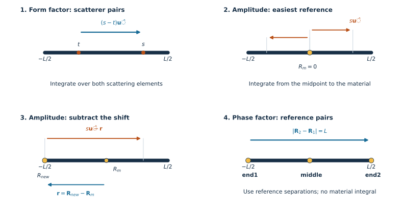
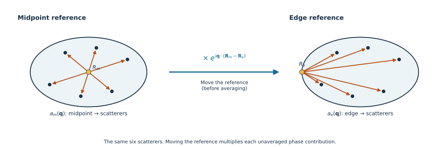

::: {.callout-note title="Before you start"}
Read [Introduction to pySEB](introduction.qmd) and
[Your first scattering model](first-model.qmd). You should know what $q$ and
a reference point mean, and be comfortable with definite integrals.
Run from `docs/tutorials` in a repository checkout, or download the YAML
below into a `models` directory beside your notebook. The executable check
uses pySEB, NumPy, and Matplotlib; no 3D viewer is needed.
:::

To derive a subunit, first specify its scattering material and the points
where other subunits may attach. Then work through these four calculations:

1. **Form factor:** vectors between all pairs of scattering elements.
2. **Amplitude at the easiest reference:** vectors from that point to the material.
3. **Amplitude at another reference:** subtract the reference displacement from those vectors.
4. **Phase factors:** vectors between the attachment references.

We will derive a **uniform, rigid, infinitesimally thin rod** and turn the
results into a usable pySEB subunit. This shape already exists as `ThinRod`;
deriving it ourselves gives us a simple example with a known answer.
The same sequence applies to a new shape, with different positions, scattering
weights, and integration limits.

## Set up the geometry once

The rod has length $L>0$, a constant excess scattering length per unit length
$b$, and total excess scattering length $\beta=bL\ne0$. Measure $s$ from its
midpoint, with $-L/2\le s\le L/2$. For a rod direction $\hat{\mathbf u}$,

$$
\mathbf R(s)=s\hat{\mathbf u},\qquad
\mathbf R_m=\mathbf 0,\qquad
\mathbf R_1=-\frac L2\hat{\mathbf u},\qquad
\mathbf R_2=\frac L2\hat{\mathbf u}.
$$

These give the `middle`, `end1`, and `end2` references. The normalized
scattering weight of an element is $b\,ds/\beta=ds/L$.

{#fig-rod-derivation-vectors fig-alt="Four rod diagrams in derivation order. The form factor uses s minus t. The midpoint amplitude uses s. Moving the reference by r changes this to s minus r. Phase factors use the separation between two named references." width="100%"}

Our solution is isotropic: rods point in all 3D directions with equal
probability. For any fixed vector $\mathbf d$ of length $d$, the orientation
average is

$$
\left\langle e^{i\mathbf q\cdot\mathbf d}\right\rangle
=\frac12\int_{-1}^{1}e^{iqd\mu}\,d\mu
=\operatorname{sinc}(qd),
\qquad \operatorname{sinc}(x)=\frac{\sin x}{x},\quad\operatorname{sinc}(0)=1.
$$

Here $\mu$ is the cosine of the angle between the vector and $\mathbf q$.
This is the calculation rule we need: **draw the vector, find its length,
then average its contribution**. The rod is rigid, so no conformational
average is required. For a flexible subunit, also average over its conformations.

## 1. Derive the form factor from scatterer pairs

Choose two scattering elements at $s$ and $t$. Their separation vector is

$$
\mathbf d_{st}=\mathbf R(s)-\mathbf R(t)=(s-t)\hat{\mathbf u}.
$$

The form factor sums over **both** elements, with their scattering weights:

$$
F(q)=\frac1{L^2}\int_{-L/2}^{L/2}\!ds
\int_{-L/2}^{L/2}\!dt\;
\operatorname{sinc}\!\left(q|s-t|\right).
$$

For separation $u>0$, the allowed pairs occupy length $L-u$ along the rod.
The two orders of each pair give

$$
F(q)=\frac2{L^2}\int_0^L(L-u)\operatorname{sinc}(qu)\,du.
$$

Set $x=qL$ and define the sine integral
$\operatorname{Si}(x)=\int_0^x\sin(t)/t\,dt$. Integrating the two terms gives

$$
\boxed{F(q)=\frac{2\operatorname{Si}(x)}x
+\frac{2(\cos x-1)}{x^2}.}
$$

Use the limit $F(0)=1$. pySEB writes $\operatorname{Si}(x)/x$ as `six(x)`,
so the YAML expression will be `2 * six(x) + 2 * (cos(x) - 1) / x^2`.
`six(x)` and `sinc(x)` are different functions.

No attachment reference entered this calculation. Moving or adding a
reference will leave $F$ unchanged.

## 2. Derive the amplitude at the easiest point

The midpoint is the convenient reference because the two halves of the
rod are identical. The vector from it to a scattering element is simply

$$
\mathbf d_m(s)=\mathbf R(s)-\mathbf R_m=s\hat{\mathbf u}.
$$

An amplitude uses **one** scattering integral, starting at this reference.
Before orientation averaging, write

$$
a_m(\mathbf q)=\frac1L\int_{-L/2}^{L/2}
e^{i\mathbf q\cdot s\hat{\mathbf u}}\,ds,
\qquad A_m(q)=\langle a_m(\mathbf q)\rangle.
$$

Lowercase $a$ keeps the rod orientation; uppercase $A$ is the averaged
amplitude used by pySEB. Applying the distance rule gives

$$
A_m(q)=\frac1L\int_{-L/2}^{L/2}\operatorname{sinc}(q|s|)\,ds
=\frac2L\int_0^{L/2}\operatorname{sinc}(qs)\,ds.
$$

Therefore

$$
\boxed{A_m(q)=\frac{\operatorname{Si}(x/2)}{x/2}
=\mathrm{six}(x/2).}
$$

For another shape, choose whichever point makes this integral easiest:
a symmetry centre, an endpoint, or an origin suited to the integration limits.
It need not be the reference where you eventually want to attach another subunit.

## 3. Move the amplitude reference by subtracting a vector

Let the displacement **from the easy reference to the desired reference** be

$$
\mathbf r=\mathbf R_{\mathrm{new}}-\mathbf R_m.
$$

The vector from the new reference to the same scattering element is

$$
\boxed{\mathbf d_{\mathrm{new}}(s)=\mathbf d_m(s)-\mathbf r.}
$$

That subtraction is the central construction. The material has not moved;
we have changed the starting point of every reference-to-scatterer vector.

{#fig-scattering-distance-vectors fig-alt="The same generic object is shown with midpoint-to-scatterer and edge-to-scatterer arrows. A connecting arrow labels the exponential multiplier for moving the reference, before averaging." width="100%"}

This sketch illustrates the vector change for a generic object; the outlined
object is not the rod. Its connecting exponential follows directly from
substituting the new vector:

$$
e^{i\mathbf q\cdot(\mathbf d_m(s)-\mathbf r)}
=e^{-i\mathbf q\cdot\mathbf r}e^{i\mathbf q\cdot\mathbf d_m(s)}.
$$

Equivalently, before orientation averaging,

$$
a_{\mathrm{new}}(\mathbf q)
=e^{-i\mathbf q\cdot\mathbf r}a_m(\mathbf q)
=e^{i\mathbf q\cdot(\mathbf R_m-\mathbf R_{\mathrm{new}})}a_m(\mathbf q).
$$

The subtraction belongs **inside the exponent**. To obtain the averaged
amplitude used by pySEB, average using the new vectors:

$$
A_{\mathrm{new}}(q)=\frac1L\int_{-L/2}^{L/2}
\operatorname{sinc}\!\left(q|s\hat{\mathbf u}-\mathbf r|\right)\,ds.
$$

Both $\hat{\mathbf u}$ and this fixed-in-the-rod displacement turn together
when the rod changes orientation. Keep them together when averaging:
$A_{\mathrm{new}}$ is generally not $A_m$ times an already averaged phase factor.

### Apply the shift to a rod endpoint

For `end1`, $\mathbf r=-L\hat{\mathbf u}/2$. Thus
$\mathbf d_1(s)=(s+L/2)\hat{\mathbf u}$, with distances ranging from zero to $L$:

$$
A_1(q)=\frac1L\int_{-L/2}^{L/2}
\operatorname{sinc}\!\left(q(s+L/2)\right)\,ds
=\frac1L\int_0^L\operatorname{sinc}(qu)\,du.
$$

Therefore

$$
\boxed{A_1(q)=A_2(q)=\frac{\operatorname{Si}(x)}x=\mathrm{six}(x).}
$$

Reflection about the midpoint gives the same result for `end2`.
More generally, a reference at fraction $f$ of the length from `end1` has
$\mathbf r=(f-1/2)L\hat{\mathbf u}$. Splitting its integral at that point gives

$$
A_f(q)=f\,\mathrm{six}(fx)+(1-f)\,\mathrm{six}((1-f)x),\qquad 0\le f\le1.
$$

The endpoints $f=0,1$ and midpoint $f=1/2$ recover our three amplitudes.
The follow-up tutorial uses this same expression to add `third1` and `third2`.

## 4. Derive phase factors from reference pairs

Now put the scattering elements aside. A phase factor needs only the vector
between two references:

$$
\mathbf d_{\alpha\omega}=\mathbf R_\alpha-\mathbf R_\omega,
\qquad
\Psi_{\alpha\omega}(q)=\operatorname{sinc}
\!\left(q|\mathbf d_{\alpha\omega}|\right).
$$

For the rod, read the three separations directly from the geometry:

| Reference pair | Distance | Phase factor |
| --- | --- | --- |
| `end1`, `end2` | $L$ | $\operatorname{sinc}(x)$ |
| `end1`, `middle` | $L/2$ | $\operatorname{sinc}(x/2)$ |
| `end2`, `middle` | $L/2$ | $\operatorname{sinc}(x/2)$ |

A fixed reference paired with itself has phase factor one. There is no
scattering integral or scattering weight in these fixed-reference phase factors.

We now have all three ingredients: the object's $F$, an $A$ for each
reference, and a $\Psi$ for each distinct reference pair. All equal one at
$q=0$. The form factor is an average over scatterer **pairs**; squaring an
already averaged amplitude does not generally reproduce it.

## Put the derived expressions into a usable subunit

For the size fields, the same vectors give

$$
R_g^2=\frac1L\int_{-L/2}^{L/2}s^2\,ds=\frac{L^2}{12},\qquad
\langle d_{m,s}^2\rangle=\frac{L^2}{12},\qquad
\langle d_{1,s}^2\rangle=\langle d_{2,s}^2\rangle
=\frac1L\int_0^Lu^2\,du=\frac{L^2}{3}.
$$

Reference-to-reference mean-square distances are the squared distances in the
table above. The complete model puts these results alongside the scattering
expressions and a line for visualization:

[Download `DerivedRod.pyseb.yaml`](models/DerivedRod.pyseb.yaml){download="DerivedRod.pyseb.yaml"}

<details>
<summary>The complete rod derived on this page</summary>

```yaml

```

</details>

This teaching model exposes only the three fixed references we derived.
The bundled `ThinRod` also supplies a distributed `contour` reference.
For YAML registration details, see
[Define and validate a custom subunit](define-custom-subunit.qmd).

## Check the derivation against direct integration

Validate and register our model under its own name. Lengths below are in nm
and $q$ is in nm$^{-1}$.

```{python}
from pathlib import Path

import matplotlib.pyplot as plt
import numpy as np
from numpy.polynomial.legendre import leggauss
import pyseb

model_path = Path("models/DerivedRod.pyseb.yaml").resolve()
report = pyseb.validate_subunit_file(str(model_path))
assert report.ok, [failure.message for failure in report.failures]
world = pyseb.World("DerivedRodTutorial")
world.register_subunit_file(str(model_path))
world.Add("DerivedRod", "rod")

L = 4.0
q = np.linspace(0.0, 5.0, 180)
parameters = {"L_rod": L, "beta_rod": 1.0}
```

Use Gauss–Legendre quadrature to evaluate the original integrals, independently
of their closed-form YAML expressions. NumPy uses
`np.sinc(z) = sin(pi*z)/(pi*z)`, so divide the arguments by $\pi$.

```{python}
nodes, weights = leggauss(96)
s = L * nodes / 2
weights = weights / 2  # normalized integration measure ds/L

pair_distances = np.abs(s[:, None] - s[None, :])
F_direct = np.einsum(
    "qij,i,j->q", np.sinc(q[:, None, None] * pair_distances / np.pi),
    weights, weights,
)
A_middle_direct = np.sinc(q[:, None] * np.abs(s) / np.pi) @ weights
A_end_direct = np.sinc(q[:, None] * (s + L/2) / np.pi) @ weights
Psi_ends_direct = np.sinc(q * L / np.pi)

F = np.asarray(world.EvaluateFormFactor("rod", parameters, q.tolist()))
A_middle = np.asarray(world.EvaluateFormFactorAmplitude(
    "rod.middle", parameters, q.tolist()))
A_end = np.asarray(world.EvaluateFormFactorAmplitude(
    "rod.end1", parameters, q.tolist()))
Psi_ends = np.asarray(world.EvaluatePhaseFactor(
    "rod.end1", "rod.end2", parameters, q.tolist()))

for integrated, implemented in ((F_direct, F), (A_middle_direct, A_middle),
                                (A_end_direct, A_end), (Psi_ends_direct, Psi_ends)):
    np.testing.assert_allclose(integrated, implemented, rtol=1e-9, atol=1e-11)
    assert np.isclose(implemented[0], 1.0)

A_end2 = np.asarray(world.EvaluateFormFactorAmplitude(
    "rod.end2", parameters, q.tolist()))
np.testing.assert_allclose(A_end, A_end2)
assert np.isclose(world.EvaluateRadiusOfGyration2("rod", parameters), L**2/12)
print(f"Validated {report.case_count} reference cases; all integrals agree with pySEB.")
```

```{python}
#| label: fig-derived-rod-quantities
#| fig-cap: "One derived rod: its form factor, midpoint amplitude, endpoint amplitude, and endpoint-to-endpoint phase factor."
fig, ax = plt.subplots(figsize=(8, 4.6))
ax.plot(q, F, color="#172f46", lw=2.5, label=r"$F$")
ax.plot(q, A_middle, color="#b95017", label=r"$A_{middle}$")
ax.plot(q, A_end, "--", color="#b95017", label=r"$A_{end}$")
ax.plot(q, Psi_ends, color="#176b96", label=r"$\Psi_{end1,end2}$")
ax.axhline(0, color="0.7", lw=0.8)
ax.set(xlabel=r"$q$ [nm$^{-1}$]", ylabel="normalized value")
ax.legend()
fig.tight_layout()
plt.show()
```

`DerivedRod` can now be used in `Add` and `Link` with `end1`, `middle`, and
`end2`, just like other registered subunits. Its line drawing is for display;
the derived expressions supply its scattering.

## Apply the method to your own subunit

Choose the material and its scattering weights. Derive $F$ from scatterer
pairs, find $A$ at a convenient reference, subtract the displacement to each
required attachment, then derive $\Psi$ from every reference pair. For a
nonuniform density, replace $ds/L$ by the normalized scattering-density measure;
for flexible geometry or distributed references, include their statistical averages.

Continue to [Add a reference to an existing subunit](add-subunit-reference.qmd)
to put `third1` and `third2` on either side of the midpoint without rederiving
$F$. For the corresponding point-cloud sums and API calls, see
[Scattering from a point cloud](scattering-quantities.qmd).
