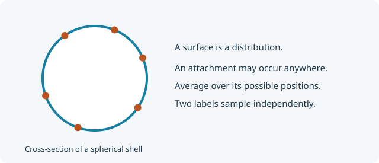

::: {.callout-note title="Step 4 of 5"}
Continue from [Add more linkage points](subunit-multiple-references.qmd).
We now add a reference distributed uniformly over the whole shell surface.
:::

## A surface reference is a distribution of positions

A fixed pole selects one coordinate on the shell. A distributed `surface`
reference says that an attachment can occur anywhere, with uniform probability
per unit area. The scattering factors average over that attachment position
as well as the scattering material and the object's orientation.

{fig-alt="Several possible attachment positions around the shell boundary, illustrating a reference distributed over the spherical surface." width="620"}

Let $\mathbf a=R\hat{\mathbf m}$ be a sampled attachment coordinate. Its
probability measure is $d\Omega_a/(4\pi)$.

## Average the amplitude over attachment positions

The distributed-reference amplitude is

$$
A_{surface}(q)=\int\frac{d\Omega_a}{4\pi}\int\frac{d\Omega}{4\pi}
\operatorname{sinc}\!\left(q|R\hat{\mathbf n}-R\hat{\mathbf m}|\right)
=\boxed{F(q)}.
$$

This equals $F$ because the attachment distribution matches the normalized
scattering distribution on this particular uniform shell. A different surface
patch or a different density distribution generally gives a different result.

A distributed reference also needs a phase to **another independent sample of
itself**:

$$
\Psi_{surface,surface}(q)=
\int\frac{d\Omega_a}{4\pi}\int\frac{d\Omega_b}{4\pi}
\operatorname{sinc}\!\left(q|\mathbf a-\mathbf b|\right)=\boxed{F(q)}.
$$

This is generally not one. Two independently sampled attachment locations
need not coincide. In contrast, one fixed reference paired with itself has
zero separation and phase one.

The centre-to-surface distance is always $R$, giving
$\Psi_{c,surface}=\operatorname{sinc}(qR)$. Either fixed pole to a uniformly
sampled surface location has phase $F(q)$.

## Add the distributed reference to YAML

Keep the fixed-reference entries from the previous page. Add `surface` to
`references.distributed`, add `surface: shell` to `expressions.amplitudes`,
and append these four pairs to `expressions.phases`:

```yaml
references:
  specific: [center, north, south]
  distributed: [surface]
```

```yaml
- references: [center, surface]
  expression: centerAmplitude
- references: [north, surface]
  expression: shell
- references: [south, surface]
  expression: shell
- references: [surface, surface]
  expression: shell
```

For `sizes.reference_to_scatterer`, add `surface: "2 * R^2"`.
For `sizes.reference_to_reference`, add $R^2$ for centre–surface and $2R^2$
for each of north–surface, south–surface, and surface–surface.
These are averages of squared distances, rather than squared average distances.

## Validate the extra average

Keep all previous cases and add surface amplitudes, pair phases, and size
checks. The independent-surface-pair check is particularly useful:

```yaml
- name: independent surface points phase
  quantity: phase
  parameters: {R: 2.0}
  references: [surface, surface]
  q: 0.5
  expected: 0.7080734182735712
- name: independent surface points distance squared
  quantity: reference_to_reference
  parameters: {R: 2.0}
  references: [surface, surface]
  expected: 8.0
```

[Download the complete stage 4 YAML](models/ContributorShell4.pyseb.yaml){download="ContributorShell4.pyseb.yaml"}

<details>
<summary>Complete YAML at this stage</summary>

```yaml

```

</details>

## Calculate two distinct surface attachments

```{python}
from pathlib import Path

import matplotlib.pyplot as plt
import numpy as np
import pyseb

model_path = Path("models/ContributorShell4.pyseb.yaml").resolve()
report = pyseb.validate_subunit_file(str(model_path))
assert report.ok, report.failures
print(f"Passed {report.case_count} YAML validation cases")

world = pyseb.World("ShellStage4")
world.register_subunit_file(str(model_path))
shell_graph = world.Add("ContributorShell", "shell")
parameters = {"R_shell": 2.0, "beta_shell": 1.0}
q = np.linspace(0.0, 3.0, 180)  # nm^-1
```

The `#` labels identify sampled attachment locations. Different labels mean
independent positions; reusing the same complete reference path means the
same attachment location:

The links below create the two named locations before we query their factors.

```{python}
world.Link("GaussianPolymer", "chain1.end1", "shell.surface#a")
world.Link("GaussianPolymer", "chain2.end1", "shell.surface#b")

A_surface = np.asarray(world.EvaluateFormFactorAmplitude(
    "shell.surface#a", parameters, q.tolist()
))
Psi_independent = np.asarray(world.EvaluatePhaseFactor(
    "shell.surface#a", "shell.surface#b", parameters, q.tolist()
))
Psi_same = np.asarray(world.EvaluatePhaseFactor(
    "shell.surface#a", "shell.surface#a", parameters, q.tolist()
))
expected = np.sinc(q * parameters["R_shell"] / np.pi)**2
np.testing.assert_allclose(A_surface, expected, rtol=1e-10, atol=1e-12)
np.testing.assert_allclose(Psi_independent, expected, rtol=1e-10, atol=1e-12)
np.testing.assert_allclose(Psi_same, np.ones_like(q))

plt.plot(q, Psi_independent, label="Two independent surface locations")
plt.plot(q, Psi_same, "--", label="The same surface location twice")
plt.xlabel(r"$q$ [nm$^{-1}$]")
plt.ylabel(r"$\Psi(q)$")
plt.legend()
plt.show()
```

## What if the linkage region is a line?

Use the same construction, but average over the chosen line instead of area.
For a uniformly sampled curve $\mathbf a(s)$ of length $\ell$, the normalized
reference measure is $ds/\ell$:

$$
A_{line}(q)=\frac1\ell\int_{line} A_{\mathbf a(s)}(q)\,ds,
\qquad
\Psi_{line,line}(q)=\frac1{\ell^2}\int_{line}\!ds\int_{line}\!dt\;
\operatorname{sinc}\!\left(q|\mathbf a(s)-\mathbf a(t)|\right).
$$

Here $A_{\mathbf a(s)}$ is the material-averaged amplitude from that fixed
curve location. The two curve samples in the phase are independent.
Also supply phases to any other references. Uniform arc length is not always
uniform in your curve parameter; include its Jacobian. This shell tutorial
implements the whole surface; the bundled `ThinRod` and `ThinCircle` supply
examples of distributed line references named `contour`.

## Next

[Visualize your subunit](subunit-visualization.qmd).
