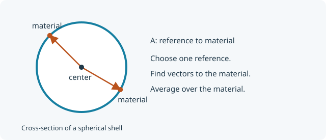

::: {.callout-note title="Step 2 of 5"}
Start with [Contribute your own subunit](contribute-subunit.qmd).
Here we derive the centre-reference amplitude included in the starting file
and add its validation cases. The form factor stays unchanged.
:::

## A linkage point needs a reference amplitude

$F(q)$ describes pairs of scattering elements inside a subunit. To calculate
interference with an attached subunit, pySEB also needs to know where its
material lies **relative to the attachment reference**. That quantity is the
**form-factor amplitude**, $A_\alpha(q)$.

{fig-alt="A reference at the empty shell centre, with arrows to scattering material on the boundary." width="620"}

For a fixed reference at $\mathbf R_\alpha$,

$$
A_\alpha(q)=\int\frac{d\Omega}{4\pi}
\operatorname{sinc}\!\left(q|R\hat{\mathbf n}-\mathbf R_\alpha|\right).
$$

This uses **one material integral**, rather than the two material integrals
in $F$. The reference itself adds no scattering material.

## Calculate the centre amplitude

At `center`, $\mathbf R_c=\mathbf0$, so every reference-to-material distance
is $R$:

$$
\boxed{A_c(q)=\operatorname{sinc}(qR)},\qquad
\langle d_{c,s}^2\rangle=R^2.
$$

A reference can sit inside the empty shell. It is an attachment coordinate;
it does not require a scattering element at that location.

For two independently oriented subunits joined at references $\alpha$ and
$\omega$, their unnormalized scattering contains the cross contribution
$2\beta_1\beta_2 A_{1\alpha}(q)A_{2\omega}(q)$. This is why a form factor
alone does not supply everything needed for a link. The factorization assumes
the freely jointed, independent orientations used by these links.

## The reference-related YAML entries

The starting file already contains these entries to meet the YAML contract.
We can now account for each one:

```yaml
definitions:
  shell: "sinc(x)^2"
  centerAmplitude: "sinc(x)"
references:
  specific: [center]
  distributed: []
expressions:
  form_factor: shell
  amplitudes:
    center: centerAmplitude
  phases: []
sizes:
  radius_of_gyration_squared: "R^2"
  reference_to_scatterer:
    center: "R^2"
  reference_to_reference: []
```

There is no nontrivial reference pair yet. A fixed reference paired with
itself has phase factor one and separation zero; those entries are implicit.

## Add amplitude validation

Keep the previous form-factor cases and append these to `validation.cases`:

```yaml
- name: center amplitude at zero
  quantity: amplitude
  parameters: {R: 2.0}
  references: [center]
  q: 0.0
  expected: 1.0
- name: center amplitude at qR=1
  quantity: amplitude
  parameters: {R: 2.0}
  references: [center]
  q: 0.5
  expected: 0.8414709848078965
- name: center to material squared
  quantity: reference_to_scatterer
  parameters: {R: 2.0}
  references: [center]
  expected: 4.0
```

[Download the complete stage 2 YAML](models/ContributorShell2.pyseb.yaml){download="ContributorShell2.pyseb.yaml"}

<details>
<summary>Complete YAML at this stage</summary>

```yaml

```

</details>

## Compare the amplitude with the form factor

```{python}
from pathlib import Path

import matplotlib.pyplot as plt
import numpy as np
import pyseb

model_path = Path("models/ContributorShell2.pyseb.yaml").resolve()
report = pyseb.validate_subunit_file(str(model_path))
assert report.ok, report.failures
print(f"Passed {report.case_count} YAML validation cases")

world = pyseb.World("ShellStage2")
world.register_subunit_file(str(model_path))
shell_graph = world.Add("ContributorShell", "shell")
parameters = {"R_shell": 2.0, "beta_shell": 1.0}
q = np.linspace(0.0, 3.0, 180)  # nm^-1
```

```{python}
A_center = np.asarray(world.EvaluateFormFactorAmplitude(
    "shell.center", parameters, q.tolist()
))
F = np.asarray(world.EvaluateFormFactor("shell", parameters, q.tolist()))
A_direct = np.sinc(q * parameters["R_shell"] / np.pi)
np.testing.assert_allclose(A_center, A_direct, rtol=1e-10, atol=1e-12)

plt.plot(q, F, label=r"$F$")
plt.plot(q, A_center, label=r"$A_{center}$")
plt.axhline(0, color="0.7", lw=0.8)
plt.xlabel(r"$q$ [nm$^{-1}$]")
plt.ylabel("Normalized value")
plt.legend()
plt.show()
```

The amplitude can be negative. It is a building block for the interference
calculation, rather than a measured intensity.

## Use the reference to attach a subunit

The validated stage-2 file already supports a link:

```{python}
world.Link("GaussianPolymer", "chain.end1", "shell.center")
world.Add(shell_graph, "assembly")
linked_parameters = dict(parameters, Rg_chain=1.0, beta_chain=1.0)
linked = world.EvaluateFormFactor("assembly", linked_parameters, q.tolist())

plt.plot(q, linked)
plt.xlabel(r"$q$ [nm$^{-1}$]")
plt.ylabel("Linked shell–chain F(q)")
plt.show()
```

There is no display geometry in our YAML yet; we add it on the final page.
A link at the centre is a mathematical model: it does not impose steric
exclusion between the chain and the shell.

## Next

[Add more linkage points](subunit-multiple-references.qmd).
