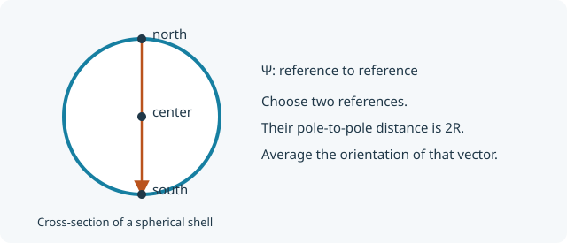

::: {.callout-note title="Step 3 of 5"}
Continue from [Add one linkage point](subunit-linkage-point.qmd).
We keep `center`, add `north` and `south`, and retain the original form factor.
:::

## Add two fixed references

Put the north and south references at opposite poles:

$$
\mathbf R_n=(0,0,R),\qquad \mathbf R_s=(0,0,-R).
$$

{fig-alt="North and south references at opposite poles of the shell, separated by 2R, and the reference at the centre." width="620"}

Each new reference needs its own form-factor amplitude. Starting from north,
the vector to a scattering element is $R\hat{\mathbf n}-R\hat{\mathbf z}$.
With $\mu=\hat{\mathbf n}\cdot\hat{\mathbf z}$, its length is
$R\sqrt{2-2\mu}$. Thus

$$
A_n(q)=\frac12\int_{-1}^{1}
\operatorname{sinc}\!\left(qR\sqrt{2-2\mu}\right)d\mu
=\boxed{\operatorname{sinc}^2(qR)}.
$$

Reflection gives the same amplitude at south. Here $A_n=A_s=F$ because every
surface point is equivalent on a uniform spherical shell. The centre amplitude
is different: $A_c=\operatorname{sinc}(qR)$.

## What is a phase factor, Ψ?

When a path through a composite structure **enters a subunit at one reference
and leaves at another**, pySEB needs the separation of those references.
The **phase factor** $\Psi_{\alpha\omega}(q)$ describes that part of the path:

$$
\Psi_{\alpha\omega}(q)=
\left\langle e^{i\mathbf q\cdot(\mathbf R_\alpha-\mathbf R_\omega)}\right\rangle
=\operatorname{sinc}\!\left(q|\mathbf R_\alpha-\mathbf R_\omega|\right)
$$

for a fixed reference pair on a rigid subunit. It uses reference-to-reference
vectors and no scattering weights. For example, scattering between two chains
attached at opposite poles includes their amplitudes and the shell's
$\Psi_{ns}$ between the two attachment locations.

| Pair | Distance | Phase factor |
| --- | --- | --- |
| `center`, `north` | $R$ | $\operatorname{sinc}(qR)$ |
| `center`, `south` | $R$ | $\operatorname{sinc}(qR)$ |
| `north`, `south` | $2R$ | $\operatorname{sinc}(2qR)$ |

**Three fixed references need three amplitudes and three distinct pair phase
factors.** Keep each unordered pair once. A reference's phase to itself is
already one.

## Update the YAML

Replace the corresponding reference and expression blocks:

```yaml
references:
  specific: [center, north, south]
  distributed: []
expressions:
  form_factor: shell
  amplitudes:
    center: centerAmplitude
    north: shell
    south: shell
  phases:
    - references: [center, north]
      expression: centerAmplitude
    - references: [center, south]
      expression: centerAmplitude
    - references: [north, south]
      expression: "sinc(2 * x)"
```

Also extend `sizes`: the mean-square reference-to-material distances are
$R^2$ at the centre and $2R^2$ at either pole. The reference-pair distances
squared are $R^2$, $R^2$, and $4R^2$, respectively. The complete file below
includes these entries.

## Extend validation with the new quantities

Append cases for both pole amplitudes, all three phases, and the new size
terms. For example, at $R=2$, $q=0.5$, the opposite-pole phase is
$\sin(2)/2=0.45464871341284085$:

```yaml
- name: opposite pole phase
  quantity: phase
  parameters: {R: 2.0}
  references: [north, south]
  q: 0.5
  expected: 0.45464871341284085
- name: pole distance squared
  quantity: reference_to_reference
  parameters: {R: 2.0}
  references: [north, south]
  expected: 16.0
```

[Download the complete stage 3 YAML](models/ContributorShell3.pyseb.yaml){download="ContributorShell3.pyseb.yaml"}

<details>
<summary>Complete YAML at this stage</summary>

```yaml

```

</details>

## Check A and Ψ against the distances

```{python}
from pathlib import Path

import matplotlib.pyplot as plt
import numpy as np
import pyseb

model_path = Path("models/ContributorShell3.pyseb.yaml").resolve()
report = pyseb.validate_subunit_file(str(model_path))
assert report.ok, report.failures
print(f"Passed {report.case_count} YAML validation cases")

world = pyseb.World("ShellStage3")
world.register_subunit_file(str(model_path))
shell_graph = world.Add("ContributorShell", "shell")
parameters = {"R_shell": 2.0, "beta_shell": 1.0}
q = np.linspace(0.0, 3.0, 180)  # nm^-1
```

```{python}
from numpy.polynomial.legendre import leggauss

mu, weights = leggauss(96)
distances = parameters["R_shell"] * np.sqrt(2.0 - 2.0 * mu)
A_north_direct = np.sinc(q[:, None] * distances / np.pi) @ (weights / 2)
A_north = np.asarray(world.EvaluateFormFactorAmplitude(
    "shell.north", parameters, q.tolist()
))
A_south = np.asarray(world.EvaluateFormFactorAmplitude(
    "shell.south", parameters, q.tolist()
))
Psi_poles = np.asarray(world.EvaluatePhaseFactor(
    "shell.north", "shell.south", parameters, q.tolist()
))
Psi_direct = np.sinc(q * 2 * parameters["R_shell"] / np.pi)
np.testing.assert_allclose(A_north, A_north_direct, rtol=1e-9, atol=1e-11)
np.testing.assert_allclose(A_south, A_north_direct, rtol=1e-9, atol=1e-11)
np.testing.assert_allclose(Psi_poles, Psi_direct, rtol=1e-10, atol=1e-12)

plt.plot(q, A_north, label=r"$A_{north}=A_{south}$")
plt.plot(q, Psi_poles, label=r"$\Psi_{north,south}$")
plt.axhline(0, color="0.7", lw=0.8)
plt.xlabel(r"$q$ [nm$^{-1}$]")
plt.ylabel("Normalized value")
plt.legend()
plt.show()
```

The pole amplitude and the pole-to-pole phase use different distances, so
they have different curves. Adding the references has not changed the
material or its isolated form factor.

## Next

[Allow attachment anywhere on a surface](subunit-distributed-reference.qmd).
