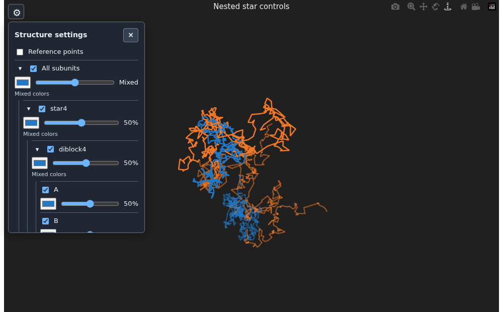
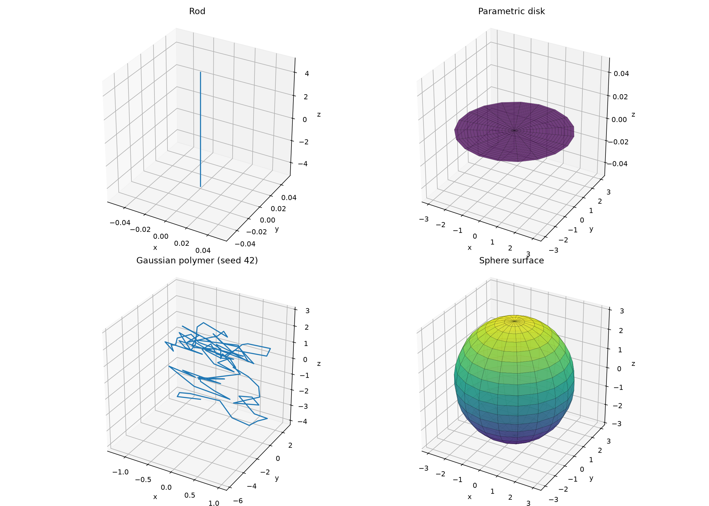

am---
title: "YAML Visualization and OpenUSD"
jupyter: python3
execute:
  echo: true
  warning: false
  error: false
---

Subunit YAML can describe representative 3D geometry, and a `World` can export
one deterministic realization as OpenUSD. For a runnable path from a user-authored
model to `.usda`, first [define a custom subunit](tutorials/define-custom-subunit.qmd),
then [save, reload, and visualize the model](tutorials/save-load-model.qmd).

## One-line interactive 3D display

Install the optional viewer dependencies once:

```bash
python -m pip install 'pyseb[visualization]'
```

For an existing world, pass its structure name and numerical parameters:

```python
pyseb.visualize(world, "assembly", parameters)
```

Drag to rotate and scroll to zoom. `pyseb.show_structure` is an alias.
For customization or notebook display, return the figure instead:

```python
figure = pyseb.structure_figure(world, "assembly", parameters, height=500)
figure.update_layout(title_text="My structure")
figure.show()
```

Both helpers accept an optional `USDExportOptions` as the fourth argument
(`options=...`) for units, seed, layout, sampling, and colors. The default
length unit is Angstrom. Parameters may be omitted for parameter-free models.
`visualize` also accepts Plotly display arguments such as `renderer="browser"`.
The viewer exports to a temporary scene and removes it before returning.
To view a saved scene, use `pyseb.visualization.usd_to_plotly(path)`.

These views show representative realizations of the scattering model.
Cloud marker sizes are display sizes rather than physical particle radii.

## Settings inside the 3D frame

Move the pointer into the view to reveal the settings button in the upper-left
corner. Click it to open a panel for showing or hiding individual subunits,
changing colors and opacity, showing reference points, and resetting the camera
or display style. The camera toolbar stays in the upper-right corner.
The panel stays open while you use it; close it with × or Escape. On touch
screens, tap the settings button directly.

Controls follow the structure hierarchy. Expand a star, then a diblock, then
an individual subunit, for example `star4 → diblock4 → A`. Visibility, color,
and opacity changes at a parent apply to every subunit inside it. A later
change to `A` affects only that leaf. Parents show mixed values when their
children differ; the **All subunits** row controls the complete structure.
Enable **Alternate connected colors** to distinguish adjoining subunits using
two colors. The viewer follows the actual connections, alternating colors along
polymer chains and branches rather than by subunit name or drawing order. Two
color pickers set the palette. Turning the checkbox off restores manual colors;
the setting persists when switching between model and unfolded views. Two colors
cannot distinguish every neighbor in a connection cycle with an odd number of
subunits.

Reference markers follow the visibility of their owning subunits. Expanded
branches and display styles are retained when switching prepared realizations.

{fig-alt="A compact settings overlay in the upper-left of a nested star structure view, expanded from star4 to diblock4 and A; the camera toolbar remains in the upper-right."}

Prepare additional realizations if you want to switch seeds and layouts inside
the panel, including in a saved HTML file:

```python
pyseb.visualize(world, "assembly", parameters,
                seeds=[1], layouts=["readable"])
```

When both layouts are prepared for a seed, a button beside the settings gear
switches between **See unfolded** and **See model**. The model view restores
the original seeded coordinates; the unfolded view uses an overlap-reduced layout.
Both keep the camera, hierarchy, colors, visibility, and opacity settings.
The readable view is illustrative and does not add excluded-volume physics.

The current seed and layout are always included. With default options, this
example prepares seeds 0 and 1 in both random and readable layouts. Preparing
more realizations takes additional export time and increases the HTML size;
it is optional. Choosing a realization preserves the camera and display styles.
These controls change the representative geometry, not the scattering model.

Returned figures keep their controls when displayed in a notebook or saved
with `figure.write_html("structure.html")`. Use `controls=False` to return a
plain Plotly figure. Static image exports show the structure without the panel.

## Opacity from scattering contrast

Enable **Opacity by scattering** in the settings panel. Choose **Total |β|**
or **Contrast density |β| / V**. The largest magnitude in the complete displayed
structure maps to opacity 1; other values scale linearly relative to it. This
factor multiplies the manual opacity sliders. Turning the checkbox off restores
manual opacity; zero beta becomes transparent, and negative beta uses its
absolute magnitude. Hover text retains the signed beta and, when available,
material volume and signed beta/volume. This is a display aid, not an intensity
calculation or a change to the fitted scattering model.

Material volumes are calculated analytically for solid spheres, spherical
shells, cylinders, and spheroids. Polymers, thin curves/surfaces, and numerical
clouds need explicit material volumes; the viewer does not use a coil's radius
of gyration or a cloud envelope as a volume. Supply known volumes in the cube
of the model's length unit, using instance paths, shared tags, or source names:

```python
pyseb.visualize(world, "starChain", parameters, volumes={"A": 1000., "B": 1600.})
```

These volume values are an example, not inferred polymer properties. Unknown
beta or volume values keep their manual opacity and are reported in the panel.
The density option is disabled when no material volumes are available. Relative
opacity and its normalization stay fixed when hiding components or switching
between the model and unfolded views. Reference markers keep their own style.

For a saved USD scene, pass the parameter dictionary to
`usd_to_plotly(path, parameters=parameters, volumes=...)`; analytic beta values
are not stored by the USD exporter. Debye sphere clouds use the signed sum of
their stored scatterer beta values. Q-dependent atomic SAXS contrast is not
inferred from atomic coordinates.

## Geometry and reference mappings

Schema version 1 model files may include a `visualization` block.  Geometry is
declared as named `curve`, `surface`, or `random_walk` patches.  Curves use a
bounded `u` domain and XYZ expressions; surfaces use bounded `u` and `v`
domains.  Random walks accept `closure: open` or `closure: bridge` and are
scaled to `target_rg`.  References select fixed positions, curve fractions, or
distributed geometry locations.  Expressions may use model parameters,
visualization definitions, domain variables (`u`, `v`, `t`), constants, and
the standard mathematical functions.

A distributed reference can expose named visualization-only `variants`.  A
reference such as `ends#top#joint7` selects the `top` variant and uses `joint7`
as the deterministic point identity.  The base scattering reference remains
`ends`; the variant affects only the representative visualization.  The legacy
one-label form `ends#joint7` continues to use the reference's normal sampling
rule.

Links constrain positions only.  A labelled distributed reference is sampled
deterministically from the export seed and instance path.  The default
`Random` layout gives each linked child one uniformly random 3D rotation;
geometry overlap is permitted.  This free orientation is only a representative
realization and does not alter pySEB's orientationally averaged scattering
calculation.  Changing the seed produces a different realization.

The optional `Readable` layout evaluates several seeded rotations for each
new child and selects the one with the best clearance from geometry already
placed.  It then performs deterministic relaxation sweeps that rotate complete
descendant subtrees around their external junctions.  These rigid subtree moves
preserve the external junction and every internal link exactly.  Directly
connected geometry participates in collision scoring after masking a small
neighborhood around its intended contact point.

Readable layout never rejects an export when overlap cannot be avoided.
Candidate scoring uses coarse geometry proxies, so this remains deterministic
best-effort layout rather than a collision-free guarantee.  Its USD metadata
identifies the orientations as optimized for readability rather than uniformly
sampled.

The exporter writes a deterministic representative realization as text USDA;
no OpenUSD runtime is required.  Use `.usda` for explicit text or `.usd` when
an interchange tool expects that extension:

```python
options = pyseb.USDExportOptions(pyseb.LengthUnit.Angstrom)
options.seed = 42
options.layout_mode = pyseb.LayoutMode.Readable
options.orientation_trials = 64
options.relaxation_sweeps = 4
options.minimum_clearance = 0.05  # In the selected model length unit.
world.export_usd("structure", "structure.usda", parameters, options)
```

The C++ API is equivalent:

```cpp
USDExportOptions options(LengthUnit::Angstrom);
options.seed = 42;
options.layoutMode = USDLayoutMode::Readable;
options.orientationTrials = 64;
options.relaxationSweeps = 4;
options.minimumClearance = 0.05;
world.ExportUSD("structure", "structure.usda", parameters, options);
```

Curve and surface resolutions default to 96 and 48 samples respectively.
Display color/opacity can be supplied in YAML style defaults or overridden by
full instance path in `USDExportOptions`.  The resulting hierarchy, curves,
meshes, point instancers, and metadata can be opened by Blender or `usdview`.

{fig-alt="Four 3D panels showing a rod curve, parametric disk, random-walk polymer, and sphere surface." width="95%"}

## Interactive examples

The following figures are built from the actual USDA files written by the
maintained Python examples. OpenUSD resolves their transforms and scene
hierarchy during the documentation build; Plotly renders the resulting meshes,
curves, and points in the browser.

```{python}
#| echo: false

from tutorials._helpers import run_usd_example, usd_to_plotly

rod_workspace, rod_usd = run_usd_example(
    "usd_rod_polymer_chain.py",
    "rod_polymer_chain.usda",
)
cloud_workspace, cloud_usd = run_usd_example(
    "usd_debye_cloud_attachment.py",
    "debye_cloud_attachment.usda",
)
cylinder_workspace, cylinder_usd = run_usd_example(
    "usd_cylinder_chain.py",
    "cylinder_chain.usda",
)
spheroid_workspace, spheroid_usd = run_usd_example(
    "usd_spheroid_chain.py",
    "spheroid_chain.usda",
)
polymers_workspace, polymers_usd = run_usd_example(
    "usd_sphere_polymers.py",
    "sphere_polymers.usda",
)
dendrimer_workspace, dendrimer_usd = run_usd_example(
    "usd_contour_linked_rod_dendrimer.py",
    "contour_linked_rod_dendrimer.usda",
)
```

### Curves and readable layout

This alternating chain combines straight parametric curves and seeded
random-walk curves. The readable layout rotates complete linked subtrees while
preserving every end-to-end junction.

```{python}
#| label: fig-interactive-rod-polymer-chain
#| fig-cap: "Interactive OpenUSD realization of an alternating rod–polymer chain."

rod_figure = usd_to_plotly(rod_usd, height=600)
rod_figure.show(config={
    "displaylogo": False,
    "scrollZoom": True,
    "responsive": True,
})
```

### Point instancing and a visual-only envelope

This scene combines a Debye `PointInstancer`, its translucent triangulated
envelope, and a parametric spheroid surface. The envelope is visual-only and
does not contribute to the scattering calculation.

```{python}
#| label: fig-interactive-debye-cloud
#| fig-cap: "Interactive OpenUSD Debye cloud, envelope, and attached spheroid."

cloud_figure = usd_to_plotly(cloud_usd, height=600)
cloud_figure.show(config={
    "displaylogo": False,
    "scrollZoom": True,
    "responsive": True,
})
```

Drag any figure to orbit, scroll to zoom, and hover to inspect resolved USD
paths. The examples execute only while Quarto builds the page; published-page
interaction runs in the browser without a Python server.

## More example structures

These gallery entries are also rendered from their maintained examples rather
than from screenshots.

::: {.grid}
::: {.g-col-12 .g-col-md-6}
```{python}
#| echo: false
#| label: fig-interactive-cylinder-chain
#| fig-cap: "Cylinder chain joined through named opposite-cap variants."

usd_to_plotly(cylinder_usd, height=475).show(config={
    "displaylogo": False,
    "scrollZoom": True,
    "responsive": True,
})
```
:::

::: {.g-col-12 .g-col-md-6}
```{python}
#| echo: false
#| label: fig-interactive-spheroid-chain
#| fig-cap: "Spheroid chain joined north-to-south through fixed references."

usd_to_plotly(spheroid_usd, height=475).show(config={
    "displaylogo": False,
    "scrollZoom": True,
    "responsive": True,
})
```
:::

::: {.g-col-12 .g-col-md-6}
```{python}
#| echo: false
#| label: fig-interactive-sphere-polymers
#| fig-cap: "Gaussian polymers attached to labelled points on a sphere surface."

usd_to_plotly(polymers_usd, height=475).show(config={
    "displaylogo": False,
    "scrollZoom": True,
    "responsive": True,
})
```
:::

::: {.g-col-12 .g-col-md-6}
```{python}
#| echo: false
#| label: fig-interactive-contour-rod-dendrimer
#| fig-cap: "Contour-linked rod dendrimer laid out for readability."

usd_to_plotly(dendrimer_usd, height=475).show(config={
    "displaylogo": False,
    "scrollZoom": True,
    "responsive": True,
})
```
:::
:::

## Maintained examples

For example, a cone needs no C++ registration: define a `surface` patch with
`coordinates: ["(1-u) * R * cos(v)", "(1-u) * R * sin(v)", "u * H"]`,
`u: {lower: 0, upper: 1}`, and `v: {lower: 0, upper: "2*pi"}` in YAML.

The complete sphere-and-rods example is available in
`pyseb/examples/python/usd_sphere_rods.py`.
The corresponding sphere-and-polymers example is in
`pyseb/examples/python/usd_sphere_polymers.py`.
A contour-linked binary rod dendrimer is demonstrated in
`pyseb/examples/python/usd_rod_dendrimer.py`.
The contour-to-contour variant is in
`pyseb/examples/python/usd_contour_linked_rod_dendrimer.py`.
A 100-circle center-to-contour chain is demonstrated in
`pyseb/examples/python/usd_circle_chain.py`.
A 100-sphere center-to-surface chain is demonstrated in
`pyseb/examples/python/usd_sphere_chain.py`.
A 20-cylinder end-to-end chain, selecting opposite cap variants on every
interior cylinder, is demonstrated in
`pyseb/examples/python/usd_cylinder_chain.py`.
An alternating 10-rod/10-polymer chain joined exclusively through `end1` and
`end2` is demonstrated in `pyseb/examples/python/usd_rod_polymer_chain.py`.
A 20-spheroid chain joined from each `north` pole to the next `south` pole is
demonstrated in `pyseb/examples/python/usd_spheroid_chain.py`.
A Debye sphere cloud attached through its named `join` reference to an analytic
spheroid is demonstrated in
`pyseb/examples/python/usd_debye_cloud_attachment.py`.

Debye clouds include a translucent visualization-only envelope by default.
The envelope is a triangulated union of inflated scatterer spheres; automatic
padding connects the cloud while preserving its irregular outline.  Configure
it with `debye_envelope`, `debye_envelope_resolution`,
`debye_envelope_padding` (`-1` selects automatic padding), and
`debye_envelope_opacity` in `USDExportOptions`.  The USD mesh is marked with
`pyseb:visualOnly = true` and contributes no scattering physics.
